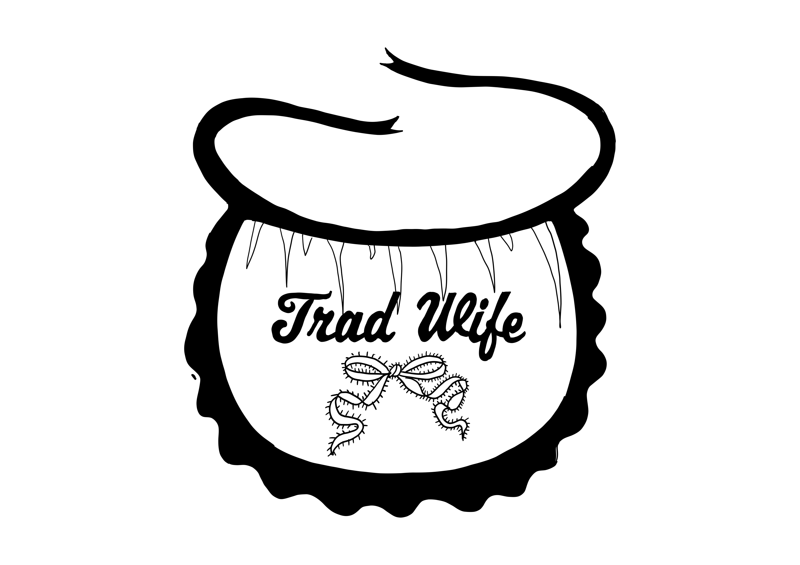

***A woman in a floral dress kneads bread and tells you she gave up her job to serve her husband. Is she at work right now?***

**Literal meaning:** **[[Tradwife]]** is a blend of *traditional* and *wife* ([Wiktionary](https://en.wiktionary.org/wiki/tradwife "Read the Wiktionary entry for tradwife.")). The tradition is a particular one: Wiktionary places it in the Western middle-class femininity of the mid-twentieth century, the housewife of the 1950s. Shortened to *trad*, a way of life becomes a label you can put in a bio or a hashtag. The word is used for women who take on this role as a values-driven lifestyle choice, keeping house, raising children and deferring to a male [[Provider|provider]], and for women who show that life online as [[Influencer|influencers]] in the [[Creator Economy|creator economy]]. ==How many women live as tradwives is unknown, and research follows the ones who post== ([[Sykes-Tradwife-2024|Sykes & Hopner, 2024]]: thirty-six accounts, each chosen because it had at least 10,000 followers). ==A Dutch woman of 23 put the difference plainly: "There's always been a group of people, like religious people, who were already doing this anyway. Others are now just selling it online"== ([[Heldoorn-Tradwife-2026|Heldoorn et al., 2026]]: interviews with sixteen Dutch women about tradwife videos, 2024). In 2025 the ==Cambridge Dictionary==[^cambridge] added the word.

**Origin:** The word first appeared in a newspaper in June 2018, when [[Secondary-Tradwife#1. The Housewives of White Supremacy|Annie Kelly (2018)]] wrote in *The New York Times* about "the housewives of white supremacy", women whose homemaking content carried white nationalist ideas. Its first public face was British. In January 2020 a BBC film showed the homemaker and author ==Alena Kate Pettitt==[^pettitt] ironing her husband's shirts, "submitting to and spoiling my husband like it's 1959". In July 2024 the *Sunday Times Magazine* introduced Hannah Neeleman of [Ballerina Farm](https://www.instagram.com/ballerinafarm/ "See the Ballerina Farm account on Instagram.") as "the queen of the trad wives" ([[Secondary-Tradwife#2. Meet the queen of the 'trad wives' (and her eight children)|Agnew, 2024]]). ==She told a New York Times reporter that she had never heard the word before the paper contacted her== ([[Heldoorn-Tradwife-2026|Heldoorn et al., 2026]]: citing Malone Kircher in The New York Times, 2024), and ==the argument that followed==[^neeleman] made **[[Tradwife|tradwife]]** known far beyond the women it was first used for.

<small>*By Narrative Typographer Marieke de Vogel*</small>

> Domestic femininity performed as aspirational content, where the rejection of professional identity is distributed as a lifestyle brand.

**The Appeal:** **[[Tradwife]]** content answers a real tiredness. ==Women gained ground at work and much less at home, where men still do less than half of the housework and much less of the planning== ([[Secondary-Tradwife#14. Not the Solution We Proposed: Feminist Psychological Insights into the Tradwife Phenomenon|Betz et al., 2026]]: the introduction to a special issue of seven studies on tradwives). The tradwife names feminism as the cause and offers a way out: stop trying to have it all. ==During the pandemic, when people baked bread and planted gardens, feeds of cottagecore and homemaking carried many women on to tradwife videos== ([[Secondary-Tradwife#14. Not the Solution We Proposed: Feminist Psychological Insights into the Tradwife Phenomenon|Betz et al., 2026]]: drawing on Hopner and Sykes, 2026). The kitchen is calm, and housework that usually goes unseen is shown as worth something. For some women it is also an economic calculation, the pattern that [[Hypergamy]] names: marrying a partner with more money or status. ==Even in Norway, where women and men work in roughly equal numbers, a husband on average has better earning prospects than his wife, couples then tend to put his career first, and that may explain part of the pay gap that remains== ([[Almas-Hypergamy-2023|Almås et al., 2023]]: register data on everyone born in Norway between 1952 and 1975, earning prospects measured by the parents' income).

**The Friction:** She is at work: the video that tells women they need not earn is how she earns. ==Of thirty-six tradwife accounts followed for ten months, all but one made money, through adverts, brand deals and small businesses, such as a course on growing your social media without it taking over your life as a homemaker== ([[Sykes-Tradwife-2024|Sykes & Hopner, 2024]]: accounts on Instagram, Facebook, X, YouTube, TikTok and smaller platforms, observed in 2022). The same study found the soft and the hard version in one account. ==On Instagram and Facebook, where moderation is stricter, the women shared homemaking and #tradlife, while on X, YouTube, Rumble and Gab the same women argued against feminism and trans rights and tried to radicalise their followers== ([[Sykes-Tradwife-2024|Sykes & Hopner, 2024]]: the most controversial posts drew the most reactions). That makes the calm kitchen the way in, and the [[Wellness-to-Alt-Right Pipeline]], the route from lifestyle content to far-right ideas, a strategy rather than a coincidence. ==Dutch women who watched these videos noticed that she earns while her message is that her husband should be the provider, and asked who could afford the life without family money, yet none of them connected it to the misogyny and white supremacism that research warns about== ([[Heldoorn-Tradwife-2026|Heldoorn et al., 2026]]: sixteen women aged 21 to 76, after watching the NPO series Girls of Tradition).

**Why This Matters:** Once you know the word, a homemaking video is also a business, and sometimes a political message. You notice it when a video about baking bread ends with a link to a course, or with a remark about what "real women" do. Then you can ask who earns from it, and whether the woman in it chose this life and respects women who choose otherwise. The tiredness it answers is real, and feminism answers it differently: ==an income of your own, so that you can still stand on your own feet if your life takes a different course== ([[Heldoorn-Tradwife-2026|Heldoorn et al., 2026]]: why the Dutch women who rejected the trend valued work and study), and ==care at home that men share, because it matters to everyone== ([[Secondary-Tradwife#14. Not the Solution We Proposed: Feminist Psychological Insights into the Tradwife Phenomenon|Betz et al., 2026]]: valuing care in a feminist way means men take it on too). In the Netherlands that is slowly happening: ==mothers who had their first child around 2017 earned a third less from work six years later, where mothers twenty years earlier earned more than half less, and nine in ten fathers now take birth leave== ([[Secondary-Tradwife#17. Emancipatiemonitor 2026|CBS, 2026]]: Emancipatiemonitor, Statistics Netherlands). ==Some women who tried the life now post about leaving it== ([[Secondary-Tradwife#14. Not the Solution We Proposed: Feminist Psychological Insights into the Tradwife Phenomenon|Betz et al., 2026]]: on Hopner and Sykes's study of women who de-tradded).

[^cambridge]: "A married woman, especially one who posts on social media, who stays at home doing cooking, cleaning, etc. and has children that she takes care of. Tradwife is short for traditional wife." Cambridge University Press called it "a growing, controversial Instagram and TikTok trend that embraces traditional gender roles". [[Secondary-Tradwife#16. Tradwife — Cambridge Dictionary|Cambridge Dictionary: 'Tradwife']]

[^pettitt]: Pettitt had blogged about staying at home since the late 2000s and never used the word herself; it was attached to her, and stuck. In her own summary of what happened to it next, it became an aesthetic, then politicised, then "its own monster". [[Secondary-Tradwife#12. The Rise and Fall of the Trad Wife|Elmhirst: 'The Rise and Fall of the Trad Wife']]

[^neeleman]: Readers split. On Neeleman's own Instagram, where followers choose to be, most comments approved, while readers of the newspaper mostly read the same life as a warning (Founti, 2025). In Jezebel, Kady Ruth Ashcraft wrote that painting Neeleman purely as a victim absolves her of her part in the fantasy. [[Secondary-Tradwife#3. A Peek Behind the Ballerina Farm Facade Is Bleak as Hell|Ashcraft: 'A Peek Behind the Ballerina Farm Facade Is Bleak as Hell']]

**In the text:** [[Provider]] · [[Influencer]] · [[Creator Economy]] · [[Hypergamy]] · [[Wellness-to-Alt-Right Pipeline]] · [[SMV (Sexual Market Value)]] · [[Purity Culture]] · [[Looksmaxxing]] · [[Sigma Male]] · [[Stay-at-home Girlfriend (SAHG)]] · [[Womanosphere]] · [[Cleanfluencer]] · [[Great Replacement]] · [[Pro-natalism]]

**Related terms:** [[Highlight Reel]] (the edited part: a kitchen shown without the money behind it) · [[Manosphere]] (the men's media world where the market of SMV was first spelled out) · [[Red Pill]] (what the harder accounts try to do to their followers, in the words of the manosphere) · [[Alpha Male]] (the man in this picture, as the men's side sells him) · [[Endtime Fascism]] (the golden age it promises after collapse includes households like these)

---

**Read more:**

*Primary:*
- [[Sykes-Tradwife-2024|Sykes & Hopner (2024)]] — [Tradwives: Right-Wing Social Media Influencers](https://doi.org/10.1177/08912416241246273). *Journal of Contemporary Ethnography*
- [[Heldoorn-Tradwife-2026|Heldoorn et al. (2026)]] — [#TradWives: A Qualitative Meaning-Making Study of Gendered Norms, Moral Appropriation, and Feminism](https://doi.org/10.17645/mac.11927). *Media and Communication*

*Secondary:*
- [[Secondary-Tradwife#1. The Housewives of White Supremacy|Kelly (2018)]] · [[Secondary-Tradwife#2. Meet the queen of the 'trad wives' (and her eight children)|Agnew (2024)]] · [[Secondary-Tradwife#3. A Peek Behind the Ballerina Farm Facade Is Bleak as Hell|Ashcraft (2024)]] · [[Secondary-Tradwife|Bower (2024)]] · [[Secondary-Tradwife#5. Alphas, Betas, and Incels: Theorizing the Masculinities of the Manosphere|Ging (2019)]] · [[Secondary-Tradwife#10. The performance and monetization of gender stereotypes through the case of Hannah Neeleman|Founti (2025)]] · [[Secondary-Tradwife#6. With the demands of modern life, some women are drawn to the 'tradwives' movement|UvA (2024)]] · [[Secondary-Tradwife#7. What Is a 'Tradwife' and How Does It Differ from Stay-at-Home Moms?|Parents (2024)]] · [[Secondary-Tradwife#8. The Real Problem With Tradwives|Vogue (2024)]] · [[Secondary-Tradwife#12. The Rise and Fall of the Trad Wife|Elmhirst (2024)]] · [[Secondary-Tradwife#14. Not the Solution We Proposed: Feminist Psychological Insights into the Tradwife Phenomenon|Betz et al. (2026)]] · [[Secondary-Tradwife#15. Unpacking (Alt-Right) Postfeminist Sensibilities: Theorizing the Tradwife Influencer Movement Through Case Study Analysis|Basker et al. (2026)]] · [[Secondary-Tradwife#16. Tradwife — Cambridge Dictionary|Cambridge Dictionary (2025)]] · [[Secondary-Tradwife#17. Emancipatiemonitor 2026|CBS (2026)]] · [[Secondary-Tradwife#9. Tradwife — Wikipedia|Wikipedia]] · [[Secondary-Tradwife#11. Ballerina Farm — the Instagram account|Ballerina Farm (Instagram)]] · [[Secondary-Tradwife#13. The Darling Academy — Alena Kate Pettitt's website|The Darling Academy]] — journalism, a special issue's introduction, the dictionary, Dutch statistics, the manosphere frame, and the accounts themselves

Created with AI assistance (Claude, ChatGPT, Lumo) using cartographic prompting — a research method developed within Project Digitale Alertheid, HAN CMD, 2026.

