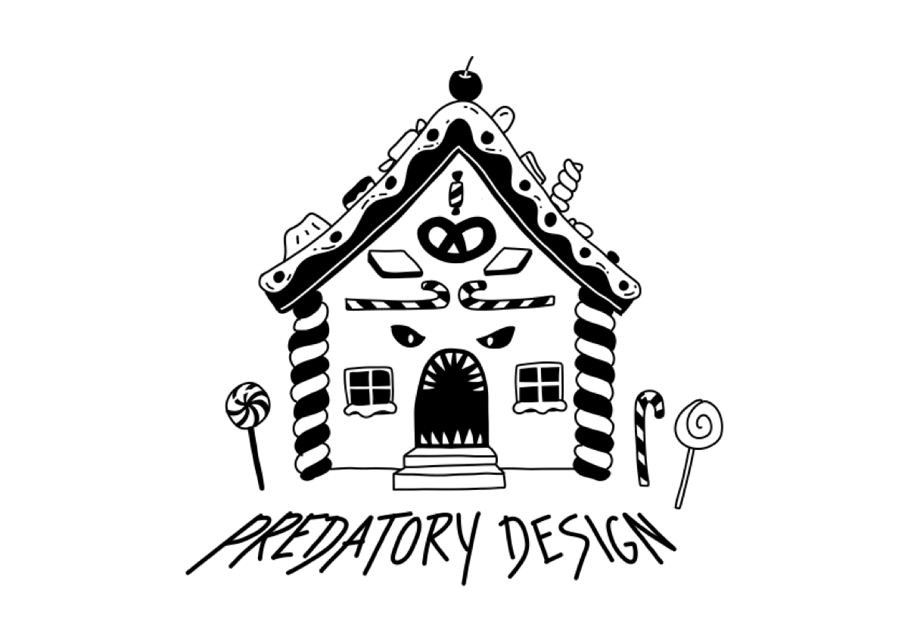

***You meant to play for ten minutes and spend nothing. Who knew in advance where you would give in?***

**Literal meaning:** *Predatory* comes from the Latin *praedator*, a plunderer or hunter; in English it also means exploiting others for personal gain ([Wiktionary](https://en.wiktionary.org/wiki/predatory "Read the Wiktionary entry for predatory.")). The word is older in finance: *predatory lending* means [imposing unfair and abusive loan terms on borrowers](https://en.wikipedia.org/wiki/Predatory_lending "Read the Wikipedia article on predatory lending."). Put next to *design*, the hunt moves into the product itself: **[[Predatory Design|predatory design]]**. In games you pay with coins such as [[Robux]], and the bill stays out of sight: ==of the games with an in-game currency, only 7 percent showed players what they had spent in total== ([[Secondary-PredatoryDesign#5. Onderzoek internationale consumententoezichthouders toont aan: veel misleiding in online games|ACM, 2025]]: consumer authorities from several countries checked 439 online games).

**Origin:** Games stopped being something you buy once and became services you keep paying for. ==Researchers studied 13 patents for in-game purchase systems that track players and adjust offers and prices to keep them spending, and warned that they could exploit vulnerable players such as adolescents and problem gamers== ([[King-PredatoryDesign-2019|King et al., 2019]]: a review of game patents from a consumer protection perspective). Two years later the practice had a name in a title, ==Predatory Monetisation?== ([[Secondary-PredatoryDesign#1. Predatory Monetisation? A Categorisation of Unfair, Misleading and Aggressive Monetisation Techniques in Digital Games from the Player Perspective|Petrovskaya & Zendle, 2021]]: 1,104 players described purchases that felt misleading, aggressive or unfair).

<small>*By [Narrative Typographer](https://digitale-alertheid.nl/narrative-typography-the-metaphoric-visualisation-of-terms/ "Read about Narrative Typography.") Anne-Marie Bruinsma*</small>

> Design that makes money from your weak spots: the thrill of chance, the fear of missing out, the wish to belong.

**The Appeal:** The game is free, the first rewards come fast, and everything looks like sweets, like the gingerbread house in *Hansel and Gretel*. On [[Roblox]] you build and play with friends, and the outfits for your avatar cost Robux. Streaks and daily rewards, the [[Gamification Creep]] of every app, bring you back tomorrow.

**The Friction:** It learns where you give in, and charges you there. A countdown on a skin, a friend who already owns it, a reward that only comes after hours of ==grinding==[^grind] unless you pay: on their own these are [[Dark Patterns]], now often called [[Deceptive Design]]. In games they are stacked, and that stacking is what makes it predatory: ==in Roblox, interface tricks and psychological tactics reinforce each other to push players to spend== ([[Secondary-PredatoryDesign#2. How Predatory Monetization Designs Manifest in Child-Friendly Video Games|Song et al., 2025]]: interviews with Roblox developers and a walkthrough of their games). [[Loot Boxes]] sell the [[Dopamine Feedback Loops|reward that sometimes comes and sometimes doesn't]] as a product, and ==the more players spent on them, the more severe their gambling problems== ([[Zendle-PredatoryDesign-2018|Zendle & Cairns, 2018]]: survey of 7,422 gamers, a link, not proof of cause). ==In January 2025 the maker of Genshin Impact agreed to pay $20 million. Players had to change real money into one currency and then another, at odd exchange rates, before they could open a loot box, while promotions and influencer campaigns made the odds look better than they were. Some children spent hundreds or even thousands of dollars.== ([[Secondary-PredatoryDesign#6. Genshin Impact Game Developer Will be Banned from Selling Lootboxes to Teens Under 16 without Parental Consent, Pay a $20 Million Fine to Settle FTC Charges|FTC, 2025]]: the US consumer regulator, the settlement still needed a judge's approval) The stack reaches beyond the game, through ==streamers==[^stream] and the same [[Parasocial Relationship]] that makes a recommendation sound like a friend's. Countdowns work on [[FOMO]], and ==38 percent of the games checked used messages about scarcity, some of them fake== ([[Secondary-PredatoryDesign#5. Onderzoek internationale consumententoezichthouders toont aan: veel misleiding in online games|ACM, 2025]]: the same 439 games).

[^stream]: In Flanders, where paid loot boxes are banned, four in ten teenagers had watched streamers open them in the past year, in a survey of 2,280 Flemish teenagers. [Grosemans et al., 2023](https://dl.digra.org/index.php/dl/article/download/2124/2123/2120)

[^grind]: Repeating the same dull task in a game to unlock something, often for hours. Gray et al. list it as a dark pattern when the game offers to skip it for money. [Gray et al., 2024](https://doi.org/10.1145/3613904.3642436)

**Why This Matters:** The moment comes later, on a bank statement or in a parent's inbox, when the coins turn back into money. The question to ask is not *how do I resist* but *who built this to make me give in?* The same tools can work the other way: a game can show what you have spent, as [[Fair Patterns]] do with the reject button. And rules are catching up: ==since October 2026 PEGI rates existing games with paid loot boxes 16, also games that were rated 3, 7 or 12== ([[Secondary-PredatoryDesign#7. PEGI updates age ratings of existing games with paid random items|PEGI, 2026]]: the European age rating).

**In the text:** [[Robux]] · [[Roblox]] · [[Gamification Creep]] · [[Dark Patterns]] · [[Deceptive Design]] · [[Loot Boxes]] · [[Dopamine Feedback Loops]] · [[Parasocial Relationship]] · [[FOMO]] · [[Fair Patterns]] · [[Gaming Disorder]] · [[Digital Divide]]

**Related terms:** [[Attention Harvesting]] (the difference: there your time, here your money at your weakest moment) · [[Ludic Loop]] (the loop with no end that keeps the offers coming) · [[Influencer]] (the streamer who opens the box on camera) · [[Creator Economy]] (streaming as a living) · [[Online Grooming]] (the same platforms, a different weak spot) · [[Screen Time]] (counting hours leaves the design out of the question) · [[Brussels Effect]] (the same Roblox investigation covers design that pushes children into buying) · [[VSD (Value Sensitive Design)]] (building values in before launch, the opposite starting point) · [[Kidfluencer]] (children selling to children on camera)

---
**Read more:**

*Primary:*
- [[King-PredatoryDesign-2019|King et al. (2019)]] — patents for in-game purchase systems that track players and tailor offers to keep them spending
- [[Zendle-PredatoryDesign-2018|Zendle & Cairns (2018)]] — the more gamers spent on loot boxes, the more severe their problem gambling

*Secondary:*
- [[Secondary-PredatoryDesign#1. Predatory Monetisation? A Categorisation of Unfair, Misleading and Aggressive Monetisation Techniques in Digital Games from the Player Perspective|Petrovskaya & Zendle (2021)]] · [[Secondary-PredatoryDesign#2. How Predatory Monetization Designs Manifest in Child-Friendly Video Games|Song et al. (2025)]] · [[Secondary-PredatoryDesign#3. Let's unbox! Gambling-like elements on Twitch and simulated gambling among Flemish teenagers|Grosemans et al. (2023)]] · [[Secondary-PredatoryDesign#4. An Ontology of Dark Patterns Knowledge: Foundations, Definitions, and a Pathway for Shared Knowledge-Building|Gray et al. (2024)]] · [[Secondary-PredatoryDesign#5. Onderzoek internationale consumententoezichthouders toont aan: veel misleiding in online games|ACM (2025)]] · [[Secondary-PredatoryDesign#6. Genshin Impact Game Developer Will be Banned from Selling Lootboxes to Teens Under 16 without Parental Consent, Pay a $20 Million Fine to Settle FTC Charges|FTC (2025)]] · [[Secondary-PredatoryDesign#7. PEGI updates age ratings of existing games with paid random items|PEGI (2026)]] · [[Secondary-PredatoryDesign#8. Age Appropriate Design: A Code of Practice for Online Services|ICO (2021)]] · [[Secondary-PredatoryDesign#9. Loot box engagement: relationships with educational attainment, employment status and earnings in a cohort of 16 000 United Kingdom gamers|Close et al. (2022)]] — research, regulators and an age rating

Created with AI assistance (Claude, ChatGPT, Lumo) using cartographic prompting — a research method developed within Project Digitale Alertheid, HAN CMD, 2026.

