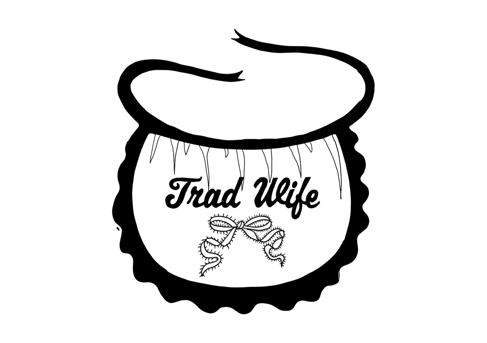

The Cabinet is a living lab, a place to experiment: that is a liberty we take. There are now three versions, shown below.

## Versions

Each version adds to the one before. Open a version to see what it brings, with an example of each part.

1<strong>First version · written and placed</strong>In every entry: the term gets a name, a first analysis in five parts, and a graph of its links.

*Online since May 2026.*

- **The term**: the curator proposes it and provides its background.
- **The text**: a language model generates it from the cartographic prompt: an **opening line**, a **definition** and **five parts** (Literal meaning, Origin, The Appeal, The Friction, Why This Matters).
- **A place in a cluster**, with links to neighbouring terms; a **graph** under the title shows those links.
- **Sources** are listed under the entry; some are also named in the text.
- **Checked**: the curator scanned the text and adjusted it where needed; its links and DOIs have been checked, but its sources were not all read before it was written. Then the entry is published.

<strong>Opening line</strong>

A situation you recognise. From the third version it ends in a question in which the term's tension sits. In [[Security Theater]]: *You took off your shoes at the airport security check and felt safer. Were you?*

<strong>Literal meaning</strong>

What the parts of the word say, and what appears when they come together that was in neither. In [[Security Theater]]: *security*, from Latin *securus*, without care, and a *theater*, a performance for an audience, where the audience is the people who are supposed to be protected.

<strong>Origin</strong>

Where the term came from, who introduced it, and how its meaning has shifted.

<strong>Definition</strong>

One sentence in plain language, set apart in a box.

<strong>The Appeal</strong>

What is true about the term, and who benefits from it.

<strong>The Friction</strong>

What the term hides, and how it works. From the third version its first sentence answers the opening line's question. In [[Security Theater]] it begins: *Often not: you do what the measure asks, and the risk stays where it was.*

<strong>Why This Matters</strong>

Why it helps to know the term, where things are done differently, and how to recognise it the next time. [[Vendor Lock-in]] ends: *The next time you sign up, or your school or employer chooses a system, ask what it would cost to leave in five years and whether you can take your data with you.*

<strong>Related terms</strong>

Other terms in the Cabinet, each with the reason it belongs beside this one. Terms the text itself discusses are linked in the text.

Above every entry stands its **semantic field**, the graph of its neighbours. The cards below show it, with the other drawings.

2<strong>Second version · mapped</strong>You discover the connections: the sources in the graph, a landscape that tells it as a story, sometimes a curve or a drawing.

*Since July 2026.*

*Related terms and backlinks were placed along a causal chain: what causes it, how it works, what follows.*
- **Sources in the graph**, with **three switches**: the sources, the other terms in the cluster, and the entries that link here without being linked back.
- **Semantic landscape**: the graph told as a story, in a bar under it; every term named in it links to its entry.
- **Sources pages** (primary and secondary) in some entries, and in some an **attention curve**.
- **Narrative Typography** in some entries: the term drawn as an image by a designer, as in [[Tradwife]].
- **Own scripts**: these layers show on the site, not in Obsidian.

<strong>Sources</strong>

Some entries in the second version, and every entry in the third, carry their sources on separate pages: at most two primary sources, peer-reviewed research that carries the analysis, and a bundle of secondary sources, from journalism to law. Every source in the text links to its page. See [[Privacy Washing]].

<strong>Narrative Typography</strong>

In some entries a designer draws the term as an image: **Narrative Typography**. Four entries have one so far: [[Tradwife]], [[Looksmaxxing]], [[Sigma Male]] and [[Predatory Design]]. In [[Tradwife]], by Narrative Typographer Marieke de Vogel:

3<strong>Third version · argued and sourced</strong>You can check it: every claim has a source you can open, every relation a reason, a curve shows when the term drew attention, and the entry ends with a question for you.

*Since October 2026, starting with [[Privacy, Data and Control]].*

*Staged: the opening line makes you an imagined actor in the situation. The entry shows what the term puts on stage, what stays in the wings, who works behind the scenes and how it plays in the public eye. Then the text breaks the fourth wall: it turns to you, and you can answer as yourself. Recognising the situation is where agency begins: the power to act, and to see what your action can do.*
- **The opening line** ends in a question about the term; **The Friction** answers it.
- **Every part** has its own question to answer: where do you already feel this, what does the term itself say, what drives it, where does it chafe, and what do you take with you.
- **Relations argued**: neighbouring terms go into the text where they help answer one of those questions. Relations no longer follow a fixed causal chain: each one is placed by the role it plays in the same situation, and every term listed under **Related terms** says why it is there.
- **Sources read first** and split into primary (research that carries the analysis) and secondary (journalism, law, statistics and background); **names** you may not know get a short explanation.
- **Attention curve** under the landscape in every entry: it counts when the word drew attention (Wikipedia page views, Google searches, peer-reviewed articles) and says what caused its peaks.
- **A whole cluster** reaches the third version when all its entries are done.

<strong>Signs in the text</strong>

Only in entries in the third version: an asterisk \* opens the source of a claim, ▾ explains a name or a word, and ↘ leads to an original document or another entry.

<strong>Relations argued in the text</strong>

A neighbouring term is discussed in the part of the entry that needs it, so the text says why the two belong together; what adds nothing to the text stays under Related terms, with a reason. In the semantic field this shows as a solid line instead of a dashed one.

**The game.** The cards of the game that IPO student Kay Freriks is developing are based on the Cabinet's terms and modelled on the card game Dark Stories: a puzzle on the front, what happened on the back. Cases from the cards come back into the entries, and the source behind a card is read first.

Every revision also checks where the term reaches you and where it is decided, on <a class="orbit-open" href="https://mastamarieke.github.io/Cabinet-of-Terms/static/orbits-of-influence.html" data-src="static/orbits-of-influence.html">the orbit map</a>. In the third version the questions behind each part, and what they rest on, were sharpened. <a class="orbit-open" href="https://mastamarieke.github.io/Cabinet-of-Terms/static/grounding.html" data-src="static/grounding.html">How this is grounded</a>

<strong>Detailed timeline of the versions</strong>

From the first word clouds to the third version. Choose a version to jump to it, or scroll through how the Cabinet grew.

<iframe class="lab-timeline" data-src="static/tijdlijn-versies.html" title="Timeline of the versions of the Cabinet" loading="lazy" style="width:100%;height:560px;border:0;display:block"></iframe>

<strong>The entries per version</strong>

<!-- layers:start -->
| | entries | which |
|---|---|---|
| **Third version**: argued and sourced | 12 | [[Beauty, Influencers & Self-Image]]: [[Cleanfluencer]] [[Platform Mechanisms & Economics]]: [[Enshittification]] [[Privacy, Data and Control]]: [[Algorithmic Violence]] · [[Brussels Effect]] · [[CLOUD Act]] · [[Data Brokers]] · [[Dataism]] · [[Privacy as a Premium]] · [[Privacy Washing]] · [[Security Theater]] · [[Surveillance Capitalism]] · [[Vendor Lock-in]] |
| **Second version**: mapped | 27 | [[AI-Specific Terms]]: [[AI-Ninja]] [[Beauty, Influencers & Self-Image]]: [[Virtual Influencer]] [[Behaviour & Relationships]]: [[Parasocial Relationship]] [[Gender & Identity]]: [[Alpha Male]] · [[Blackpill]] · [[High Value Man]] · [[Hypergamy]] · [[Incel]] · [[Looksmaxxing]] · [[Manosphere]] · [[MGTOW]] · [[NPC]] · [[Podcast-bro]] · [[Provider]] · [[Red Pill]] · [[Rizz]] · [[Sigma Male]] · [[SMV (Sexual Market Value)]] · [[Stay-at-home Girlfriend (SAHG)]] · [[Top 1% Man]] · [[Tradwife]] · [[Womanosphere]] [[Parents & Children]]: [[Predatory Design]] · [[Sharenting]] [[Platform Mechanisms & Economics]]: [[Ragebaiting]] · [[Recommender Systems]] [[Subcultural Vocabulary and Platform Language]]: [[Gooner]] |
| **First version**: written and placed | 222 | all other entries, in these clusters: [[AI and Energy]] · [[AI-Specific Terms]] · [[Beauty, Influencers & Self-Image]] · [[Behaviour & Relationships]] · [[Consequences of Digital Behaviour]] · [[Counter-Movements]] · [[Culture Wars and Political Language]] · [[Design Philosophy and Ethical Design]] · [[End-Times Thinking and Elite Survivalism]] · [[Inclusion, Accessibility and Ageing]] · [[Manifestos]] · [[New Digital Professions]] · [[Parents & Children]] · [[Platform Mechanisms & Economics]] · [[SF as Ideology]] · [[Society and Power]] · [[Statements as Analytical Object]] · [[Subcultural Vocabulary and Platform Language]] |
<!-- layers:end -->

## On every cluster page

Each cluster page has a drawing of its **relations** with the other clusters. For example [[Privacy, Data and Control]]: the panel *Relations*, under the graph at the top of the page, shows how its terms link to other clusters.

## Where to start

Three entries, one in each version, so you can see what grows: [[Security Theater]] (third version), feeling safe without being safer; [[Tradwife]] (second version), housewife life as content; and [[Phubbing]] (first version), your phone, mid-conversation.

Entries are tested with readers, and what they say goes back into the method. Tell us what you recognised, what you missed or where you got lost: [info@digitale-alertheid.nl](mailto:info@digitale-alertheid.nl).

---

<nav class="pager" aria-label="Pages about the Cabinet, page 3 of 3"><a class="pg-arrow prev" href="./how-it-is-made" aria-label="Previous page: How it is made">←How it is made</a><ol class="pg-steps"><li class="pg-step done"><a href="./">1Part 1Start</a></li><li class="pg-step done"><a href="./how-it-is-made">2Part 2How it is made</a></li><li class="pg-step now"><a href="./how-an-entry-grows" aria-current="page">3Part 3A living lab</a></li></ol></nav>
