## Cartographic Prompting

The Cabinet asks what you lose when the machine thinks for you, and it is itself written with a language model. The model drafts; the curator chooses the terms and the sources, reads, corrects, and decides where a term belongs, as described in [Cartographic Prompting](https://digitale-alertheid.nl/beyond-karpathys-llm-wiki-cartographic-prompting-as-curatorial-practice/). The model has made mistakes that look right, such as sources that do not exist and links that lead nowhere; each one that was found became a check that now runs for every entry. Sources listed under an entry that its text does not discuss are leads for anyone who wants to research the term further. The Termophile in the quote on the front page is critical of AI and uses it. More about the Cabinet itself: [Cabinet of Digital Terms: A Map of the Digital World](https://digitale-alertheid.nl/cabinet-of-digital-terms-a-map-of-the-digital-world-in-267-terms/).

==Cartographic Prompting==[^cp] is a term the curator coined, because the Cabinet is put together by prompting, curating and directing: a language model does not start from a blank page, it first gets a map.

1A term→
The curator proposes it and chooses the sources.

2The map→
The clusters, the terms already there, the writing instructions, where to look.

3Placement→
The model works out the cluster, the neighbours, and how the term differs from them.

4The curator decides→
Accepts, corrects, or goes against the model.

5The entry
Written, then revised in up to three versions, cluster by cluster.

A map does not explain a city; it shows where things are in relation to each other, where the borders run and what lies at the edges. The Cabinet does the same with words.

Claude is used in production; Claude, ChatGPT and Lumo were used while exploring. The full method: [Cartographic Prompting: Curatorial Practice Alongside Karpathy’s LLM Wiki](https://digitale-alertheid.nl/beyond-karpathys-llm-wiki-cartographic-prompting-as-curatorial-practice/).

<strong>How it is made, technically</strong>

1

First version · in Obsidian

The Cabinet began as notes in Obsidian, a program on the curator's own computer: ten vaults between 27 April and 10 May 2026, then still called <em>Kabinet van Digitale Termen</em>.

A repository on GitHub keeps every change as a version. Quartz turns the notes into a website on GitHub Pages: online from 29 April, the first full version on 26 May 2026.

23

Second and third version · in VS Code

Cartographic Prompting and vibe coding: Claude Code, working in VS Code, writes the entries and the site's own code from a description of what is needed. Lumo and ChatGPT helped with the input.

Two files guide the model: <strong>Doctor Alert</strong> (writing instructions, search directions, the clusters), which grew out of the earlier prompts Term Seeker and Lumo, and, since July 2026, <strong>CLAUDE.md</strong> (working rules, checks, and what went wrong before). Both stay on the curator's computer, and can be shared when a partner wants to work with the method.

Before a change is saved, small scripts check that every link leads somewhere, that no term exists twice and that no term is left without links. The graph, the landscape, the curve and the marks in the text are the Cabinet's own code; they show on the site, not in Obsidian, which is now used to read.

Tools and terms: ==Obsidian==[^obsidian] · ==Quartz==[^quartz] · ==GitHub==[^github] · ==VS Code==[^vscode] · ==vibe coding==[^vibe]

---

## Cabinet and visualisations

The sketches the Cabinet grew from, the parts of an entry described in [A living lab](./how-an-entry-grows), and the orbit map. Click a card to see it large, with what it shows.

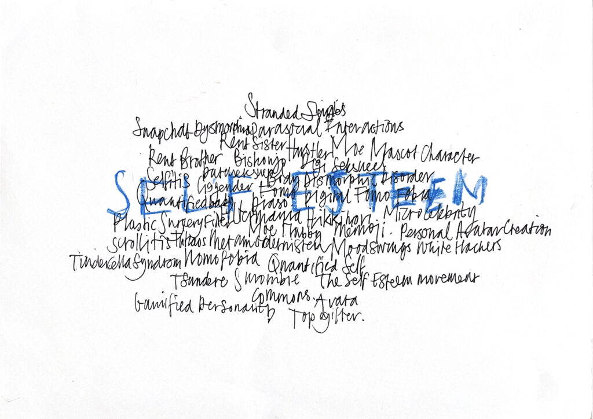
an early iteration, 2017–2018Word clouds by handBy Marieke de Vogel<button type="button" class="flip-zoom" data-img="beeld/homepage-woordwolk-self-esteem.jpg" data-alt="Word clouds by hand" aria-label="Enlarge Word clouds by hand">enlarge ⤢</button>turn ↻

Word clouds by hand

Long before there was a Cabinet, the terms were collected by hand. This cloud gathers Nomophobia, Quantified Self, Snapchat Dysmorphia, Hikikomori and Tinderella Syndrome around Self Esteem; another one, Rabbit Holes, opens the essay on cartographic prompting. They are the first sketch of the map: words that belong together, before anyone drew the lines.

turn back ↺

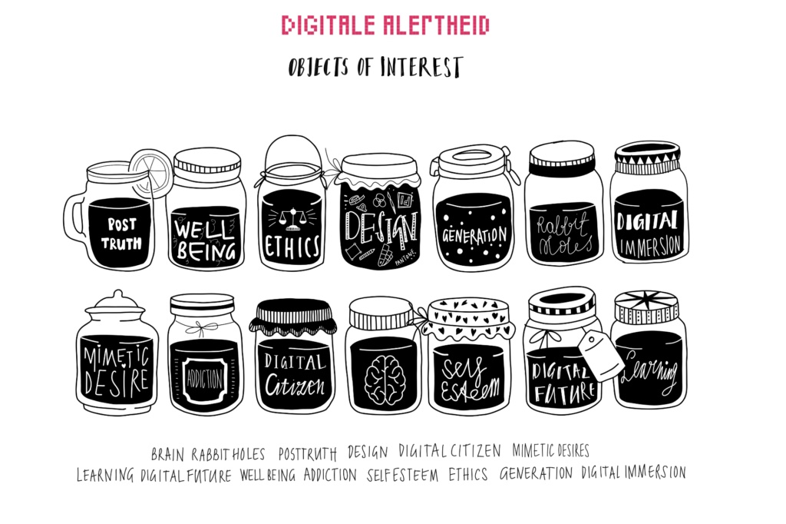
an early iteration, 2023Objects of InterestBy Marieke de Vogel<button type="button" class="flip-zoom" data-img="beeld/homepage-objects-of-interest.jpg" data-alt="Objects of Interest" aria-label="Enlarge Objects of Interest">enlarge ⤢</button>turn ↻

Objects of Interest

An early iteration of the Cabinet, before the clusters had their names: the themes as storage jars, fourteen in two rows, from Post Truth and Well Being to Self Esteem and Learning. The idea held: a cabinet keeps what would otherwise be lost.

turn back ↺

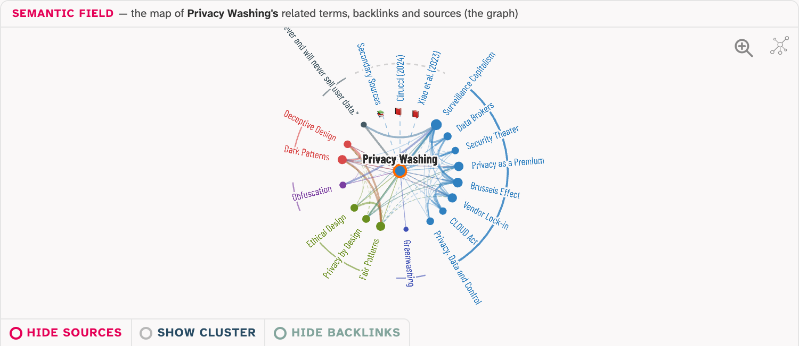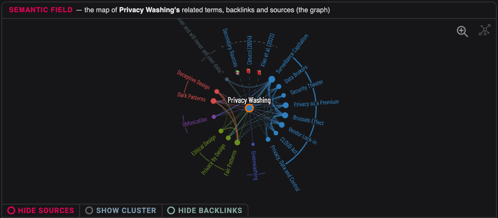
in every entrySemantic field<button type="button" class="flip-zoom" data-img="beeld/homepage-field-light.png" data-img-dark="beeld/homepage-field.png" data-alt="The semantic field of Privacy Washing" aria-label="Enlarge Semantic field">enlarge ⤢</button>turn ↻

Semantic field

The graph above every entry: the term in the middle, its neighbours on a ring grouped by cluster, its sources marked as books. An arrow shows which way a link runs; a line shows how well a relation is argued (thick: discussed in both texts, plain: in one text, dashed: only in Related terms, with a reason). Three switches show or hide the sources, the other terms in the cluster, and the entries that link here without being linked back.

[[Privacy Washing#semantic-field|Try it live in Privacy Washing ↗]]

turn back ↺

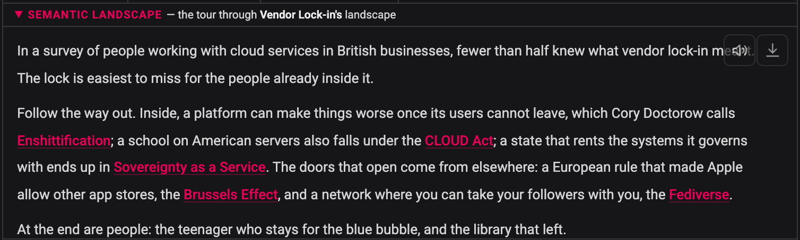
since the second versionSemantic landscape<button type="button" class="flip-zoom" data-img="beeld/homepage-landscape-light.png" data-img-dark="beeld/homepage-landscape-dark.png" data-alt="The semantic landscape of Vendor Lock-in" aria-label="Enlarge Semantic landscape">enlarge ⤢</button>turn ↻

Semantic landscape

The graph told as a short story: one thing that surprises, one thread followed through the neighbours, people at the end. The names in it are links. Vendor Lock-in begins: *In a survey of people working with cloud services in British businesses, fewer than half knew what vendor lock-in meant.*

[[Vendor Lock-in#semantic-landscape|Read it in Vendor Lock-in ↗]]

turn back ↺

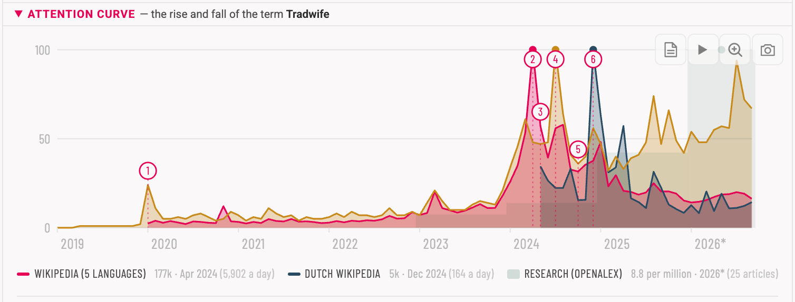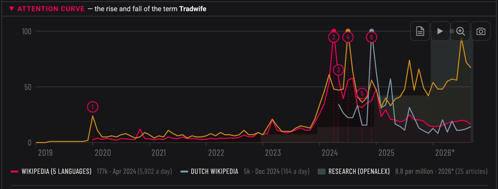
since the second versionAttention curve<button type="button" class="flip-zoom" data-img="beeld/homepage-curve-light-card.png" data-img-dark="beeld/homepage-curve-dark-card.png" data-alt="The attention curve of Tradwife" aria-label="Enlarge Attention curve">enlarge ⤢</button>turn ↻

Attention curve

When the word drew attention: Wikipedia page views, search interest and research per year, each on its own scale. Numbered moments explain the peaks, or say plainly that no cause was found. In Tradwife the highest peak, April 2024, came three months before the newspaper profile usually credited with it; the likely cause was a radio podcast, and the note says it is not proven.

[[Tradwife#attention-curve|Try it live in Tradwife ↗]]

turn back ↺

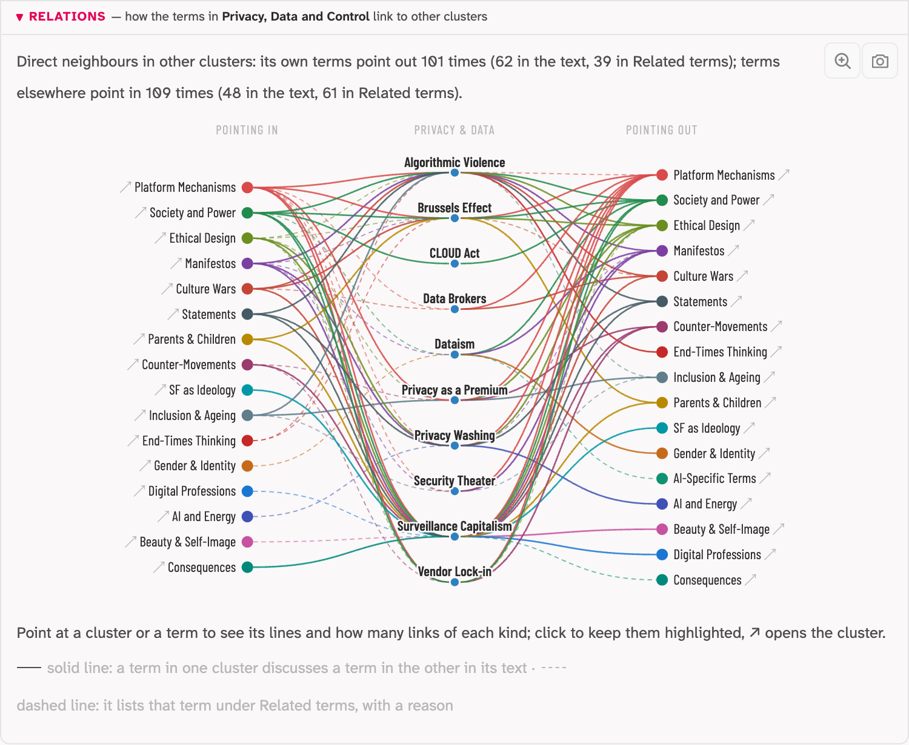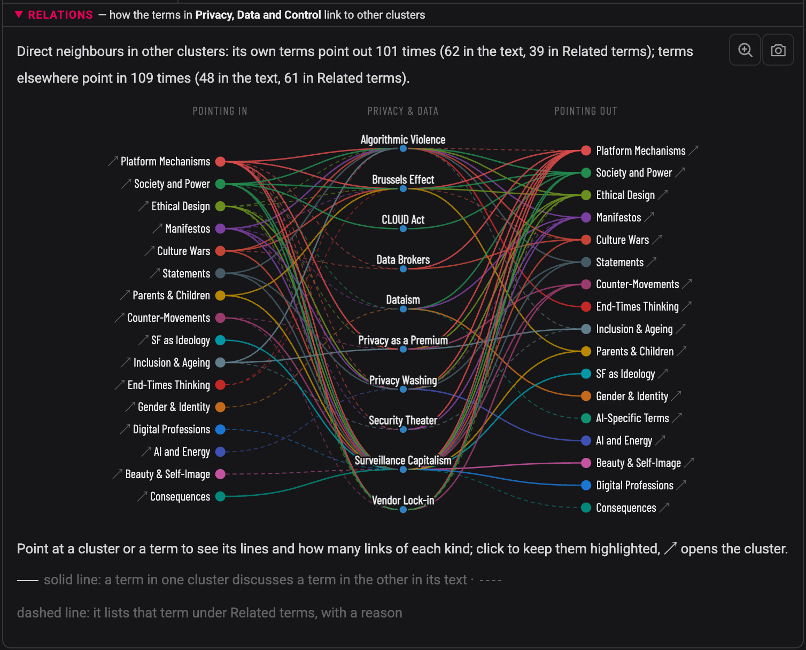
on every cluster pageRelations<button type="button" class="flip-zoom" data-img="beeld/homepage-relations-light.png" data-img-dark="beeld/homepage-relations.png" data-alt="The relations of Privacy, Data and Control" aria-label="Enlarge Relations">enlarge ⤢</button>turn ↻

Relations

On every cluster page: how its terms connect to the other clusters, in both directions. On the left the clusters whose terms point in, on the right the clusters its own terms point to. A solid line means a term discusses the other term in its text, a dashed line that it lists it under Related terms, with a reason. Point at a cluster or a term to see only its lines.

[[Privacy, Data and Control#relations|Try it live in Privacy, Data and Control ↗]]

turn back ↺

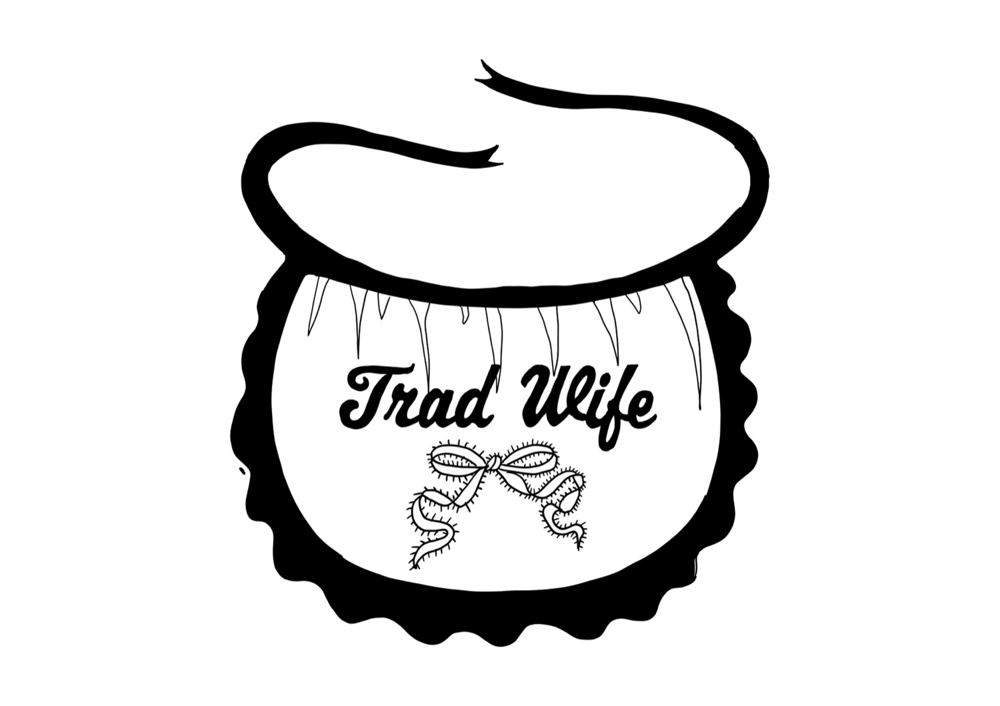
since the second version, in four entriesNarrative TypographyBy Narrative Typographer Marieke de Vogel<button type="button" class="flip-zoom" data-img="beeld/homepage-tradwife.jpg" data-alt="Tradwife, drawn as Narrative Typography" aria-label="Enlarge Narrative Typography">enlarge ⤢</button>turn ↻

Narrative Typography

The term drawn as an image by a designer, set above the definition, so the form of the word shows its meaning before you read it. So far in Tradwife (Marieke de Vogel), and in Sigma Male, Looksmaxxing and Predatory Design (Anne-Marie Bruinsma); more will follow.

[[Tradwife#narrative-typography|See it in Tradwife ↗]] · [About Narrative Typography](https://digitale-alertheid.nl/narrative-typography-the-metaphoric-visualisation-of-terms/)

turn back ↺

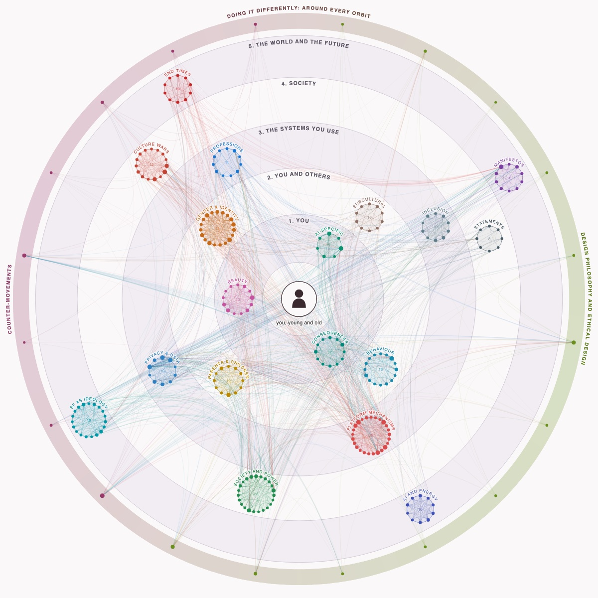
sketch · used in every revision since the third versionYou, in orbits of influence<a class="orbit-open" href="https://mastamarieke.github.io/Cabinet-of-Terms/static/orbits-of-influence.html" data-src="static/orbits-of-influence.html">Open the orbits ↗</a><button type="button" class="flip-zoom" data-img="beeld/homepage-orbits.jpg" data-alt="The clusters of the Cabinet on five orbits around a person at the centre, joined by coloured lines" aria-label="Enlarge You, in orbits of influence">enlarge ⤢</button>turn ↻

You, in orbits of influence

The cluster map of the Cabinet, rearranged around you: every cluster sits on the orbit of how close it comes to your daily life. Around it runs a band with the two clusters that do things differently, Design Philosophy and Ethical Design and Counter-Movements, on every orbit. Every line is a link between two terms, counted on 12 October 2026.

The orbits follow the psychologist ==Urie Bronfenbrenner==[^bronfenbrenner], who drew a child's world as circles around the child:

- **microsystem** (1, You): where you are, at home, at school and on your screen;
- **mesosystem** (2, You and others): where your places meet, the phone at the dinner table, the class chat at night;
- **exosystem** (3, The systems you use): places you never enter that still shape your life, such as the offices where your apps are made;
- **macrosystem** (4, Society): the beliefs, laws and words of a whole society;
- **chronosystem** (5, The world and the future): what changes over time, across generations. In Bronfenbrenner this is time itself; here it is drawn as the outermost orbit.

Jessica Navarro and Jonathan Tudge brought the model online in 2022, and found that on a screen the far circles no longer wait their turn: ==a decision taken in an office far away reaches your phone directly, with no parent or teacher in between== ([Navarro and Tudge, 2022](https://doi.org/10.1007/s12144-022-02738-3): Technologizing Bronfenbrenner, on forces from the outer systems that often circumvent parents and educators). Where a cluster sits is a choice, not a measurement. Open the orbits below, point at a cluster to see its links, and click to open it.

turn back ↺

---

<nav class="pager" aria-label="Pages about the Cabinet, page 2 of 3"><a class="pg-arrow prev" href="./" aria-label="Previous page: Start">←Start</a><ol class="pg-steps"><li class="pg-step done"><a href="./">1Part 1Start</a></li><li class="pg-step now"><a href="./how-it-is-made" aria-current="page">2Part 2How it is made</a></li><li class="pg-step next"><a href="./how-an-entry-grows">3Part 3A living lab</a></li></ol><a class="pg-arrow next" href="./how-an-entry-grows" aria-label="Next page: A living lab">A living lab→</a></nav>

[^bronfenbrenner]: Developmental psychologist at Cornell University (1917–2005). In *The Ecology of Human Development* (1979) he described how a child grows up inside nested systems, from the family to the culture around it.

[^github]: A platform for keeping projects online, built on Git, a system that tracks every change to a file, so that each step can be traced and undone. [GitHub Docs: About GitHub and Git](https://docs.github.com/en/get-started/start-your-journey/about-github-and-git)

[^obsidian]: A notes app that works with Markdown files: plain text files kept on your own computer, linked to each other so that knowledge grows as a network. [Moreno Maugliani: Een Tweede Brein bouwen met Obsidian](https://morenomaugliani.com/tweede-brein-bouwen-met-obsidian/)

[^quartz]: An open-source tool that turns Markdown files, such as Obsidian notes, into a website. [Quartz](https://quartz.jzhao.xyz/)

[^vibe]: Programming by describing a task in plain language to a language model, which writes the code. The term was coined in February 2025 by Andrej Karpathy, the same Karpathy whose LLM Wiki the essay on Cartographic Prompting answers. [Wikipedia: Vibe coding](https://en.wikipedia.org/wiki/Vibe_coding)

[^vscode]: Visual Studio Code, an open-source program for writing code and text, in which Claude Code works with the files of the Cabinet. [Visual Studio Code](https://code.visualstudio.com/)

[^cp]: Working definition: a prompting practice that takes cartography itself as input (a large language model is instructed with writing instructions, search directions, and content frameworks) so that the placement of digital terms in a relational network reveals which cluster a term belongs to and why.
