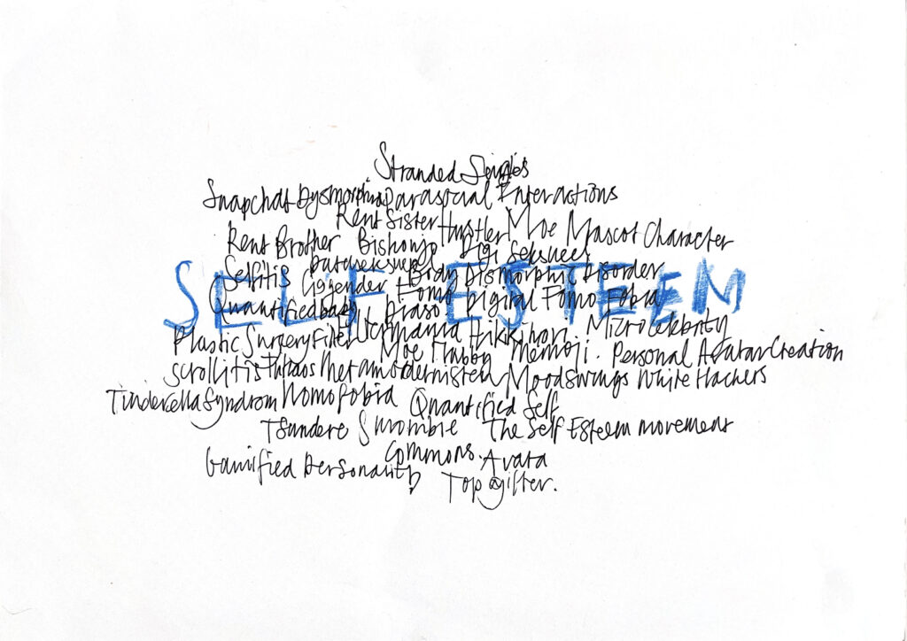
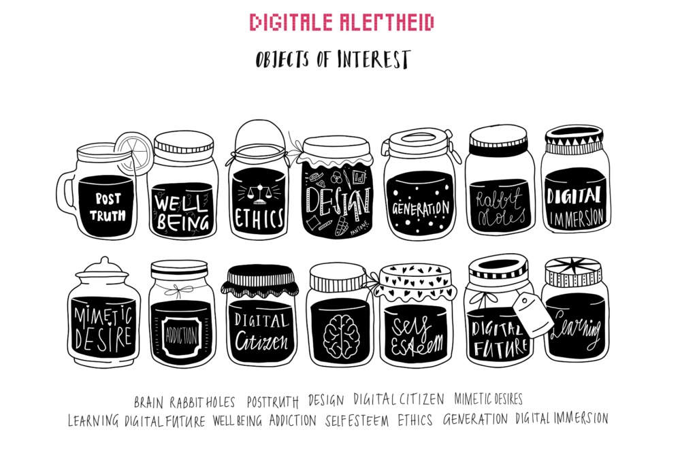
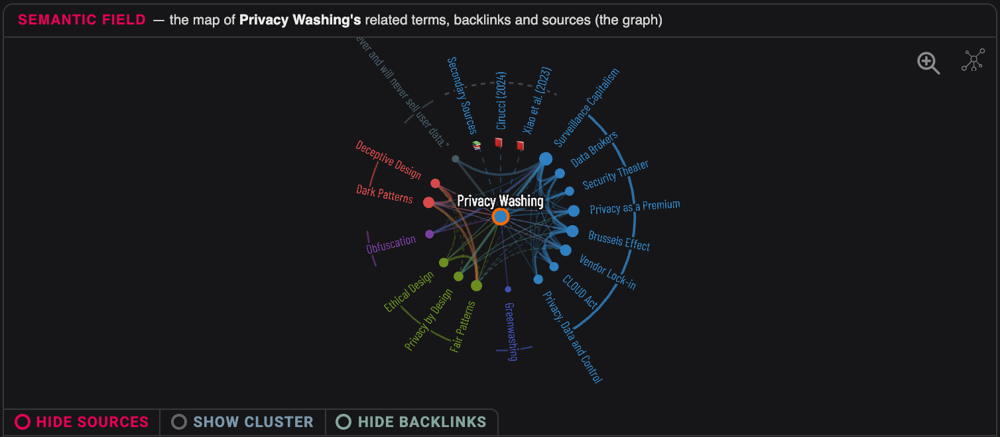
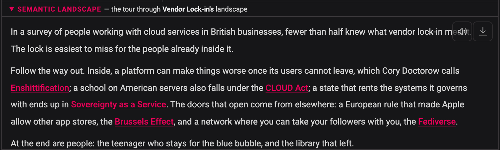
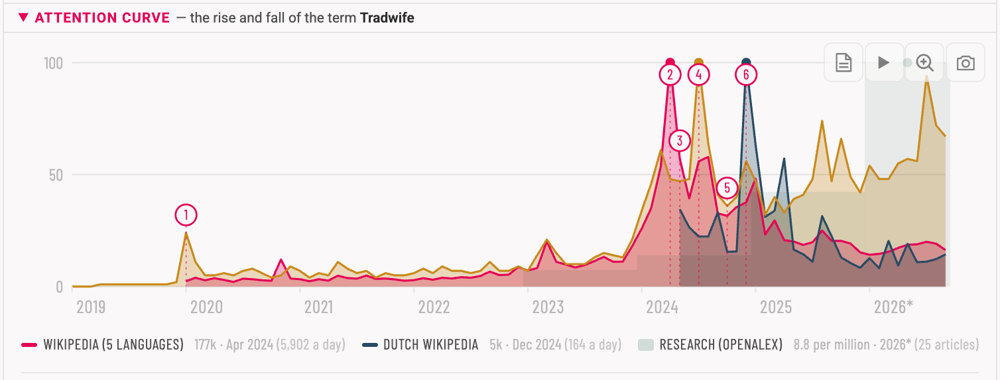
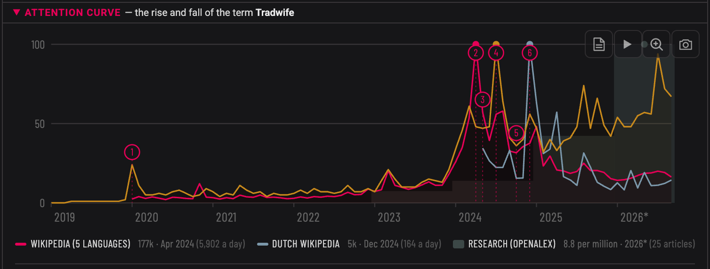
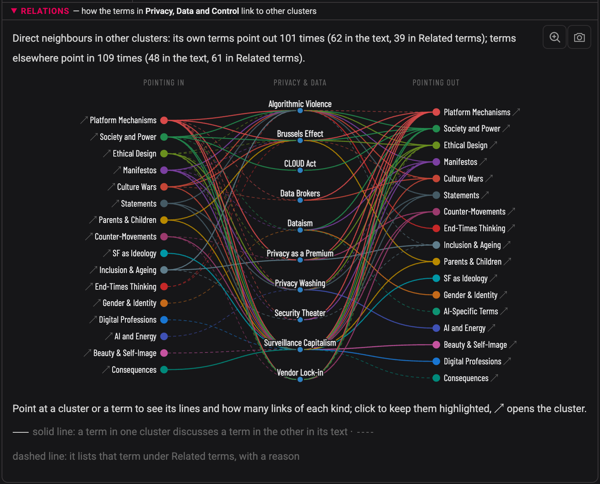
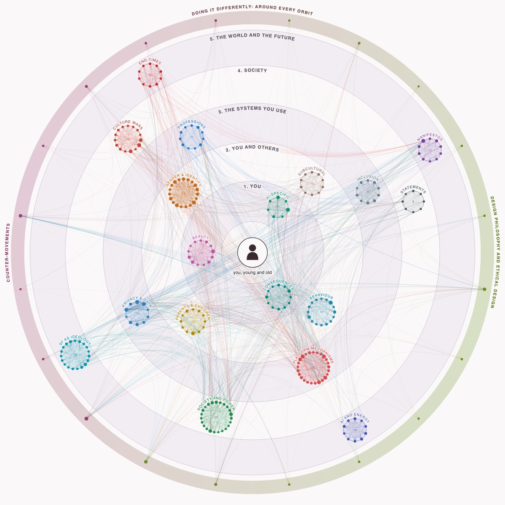

## What is the Cabinet of Digital Terms?

[[Surveillance Capitalism]], [[Dark Patterns|Dark Pattern]], [[Ghosting]], [[Red Pill]]?

You have heard these terms, and you probably use some of them. But do you know where they came from, who introduced them and why, what they make visible and what they quietly leave out?

> *Capturing moving language. Every word here is a node in a power structure. Not a definition, a map.*

The **Cabinet of Digital Terms** gathers **260+ terms** from digital media, platform culture, politics and popular culture in **20+ clusters**, with **800+ external sources**. Every entry shows where a word comes from, who benefits from it, what it hides, and which other terms it belongs with. The Cabinet does not pretend to look from nowhere. As Donna Haraway put it: "Feminist objectivity means quite simply situated knowledges."

---

## How to use the Cabinet

Wander through the Cabinet and let serendipity lead you: start with a [cluster](#browse-by-cluster) that names something you already sense but cannot yet put into words, search for a term with the search bar, or rest the pointer on a circle in the map above to see how far a cluster reaches.

Or start with a question:

- *You meant to play for ten minutes and spend nothing. Who knew in advance where you would give in?* → [[Predatory Design]]
- *You watched her clean and felt calm. She was paid for it. How much were you paid?* → [[Cleanfluencer]]
- *You took off your shoes at the airport security check and felt safer. Were you?* → [[Security Theater]]

---

## Browse by cluster

A cluster groups terms that belong to the same situation: the same platforms, the same people, the same pressure. Each cluster asks one question about the digital world, and its terms help you answer it. A term lives in one cluster, and its links show where it reaches into others.

 

drawingWhose resources are powering your query?

AI and Energyturn ↻

 
AI and EnergyWhose resources are powering your query?The material reality behind digital abstraction.10 terms<a class="go" href="Cabinet-of-Digital-Terms/AI-and-Energy/">Open cluster →</a>turn back ↺
 

 

drawingWhat do you lose when the machine thinks for you?

AI-Specific Termsturn ↻

 
AI-Specific TermsWhat do you lose when the machine thinks for you?What AI systems quietly do to the people who use them.7 terms<a class="go" href="Cabinet-of-Digital-Terms/AI-Specific-Terms/">Open cluster →</a>turn back ↺
 

 

drawingWhose standard of beauty are you measuring yourself against?

Beauty, Influencers &amp; Self-Imageturn ↻

 
Beauty, Influencers &amp; Self-ImageWhose standard of beauty are you measuring yourself against?The platform economy of appearance.14 terms<a class="go" href="Cabinet-of-Digital-Terms/Beauty,-Influencers--and--Self-Image/">Open cluster →</a>turn back ↺
 

 

drawingWhich of your habits were designed for you?

Behaviour &amp; Relationshipsturn ↻

 
Behaviour &amp; RelationshipsWhich of your habits were designed for you?The new social patterns that emerged from platform architecture.16 terms<a class="go" href="Cabinet-of-Digital-Terms/Behaviour--and--Relationships/">Open cluster →</a>turn back ↺
 

 

drawingWhat has changed in you that you have not noticed yet?

Consequences of Digital Behaviourturn ↻

 
Consequences of Digital BehaviourWhat has changed in you that you have not noticed yet?What digital systems leave behind.12 terms<a class="go" href="Cabinet-of-Digital-Terms/Consequences-of-Digital-Behaviour/">Open cluster →</a>turn back ↺
 

 

drawingIs this resistance, or is it content about resistance?

Counter-Movementsturn ↻

 
Counter-MovementsIs this resistance, or is it content about resistance?A specific mechanism: resistance that reproduces what it resists.8 terms<a class="go" href="Cabinet-of-Digital-Terms/Counter-Movements/">Open cluster →</a>turn back ↺
 

 

drawingWhat kind of response does this language make seem reasonable?

Culture Wars and Political Languageturn ↻

 
Culture Wars and Political LanguageWhat kind of response does this language make seem reasonable?Terms that frame political positions as medical threats, hostile infiltration, or biological facts.15 terms<a class="go" href="Cabinet-of-Digital-Terms/Culture-Wars-and-Political-Language/">Open cluster →</a>turn back ↺
 

 

drawingWhat would you build if you were not optimising for attention?

Design Philosophy and Ethical Designturn ↻

 
Design Philosophy and Ethical DesignWhat would you build if you were not optimising for attention?Working frameworks from designers who decided that user interest matters.12 terms<a class="go" href="Cabinet-of-Digital-Terms/Design-Philosophy-and-Ethical-Design/">Open cluster →</a>turn back ↺
 

 

drawingWho benefits from the end of the world being inevitable?

End-Times Thinking and Elite Survivalismturn ↻

 
End-Times Thinking and Elite SurvivalismWho benefits from the end of the world being inevitable?Ideologies that take collapse as given and build power or identity on it.10 terms<a class="go" href="Cabinet-of-Digital-Terms/End-Times-Thinking-and-Elite-Survivalism/">Open cluster →</a>turn back ↺
 

 

drawingWhat happens when gender becomes a market?

Gender &amp; Identityturn ↻

 
Gender &amp; IdentityWhat happens when gender becomes a market?The vocabulary of the manosphere and its adjacent spaces.19 terms<a class="go" href="Cabinet-of-Digital-Terms/Gender--and--Identity/">Open cluster →</a>turn back ↺
 

 

drawingWho was not in the room when this was built?

Inclusion, Accessibility and Ageingturn ↻

 
Inclusion, Accessibility and AgeingWho was not in the room when this was built?A blind spot in the digital debate.10 terms<a class="go" href="Cabinet-of-Digital-Terms/Inclusion,-Accessibility-and-Ageing/">Open cluster →</a>turn back ↺
 

 

drawingWho is using this concept, and to what end?

Manifestosturn ↻

 
ManifestosWho is using this concept, and to what end?The foundational texts and concepts that built the ideological architecture of the digital age.10 terms<a class="go" href="Cabinet-of-Digital-Terms/Manifestos/">Open cluster →</a>turn back ↺
 

 

drawingWho is doing the work the platform claims the algorithm does?

New Digital Professionsturn ↻

 
New Digital ProfessionsWho is doing the work the platform claims the algorithm does?Professions that emerge from digital transformation.11 terms<a class="go" href="Cabinet-of-Digital-Terms/New-Digital-Professions/">Open cluster →</a>turn back ↺
 

 

drawingWho is responsible for the child in the feed?

Parents &amp; Childrenturn ↻

 
Parents &amp; ChildrenWho is responsible for the child in the feed?The specific ways platforms exploit the vulnerabilities of minors.12 terms<a class="go" href="Cabinet-of-Digital-Terms/Parents--and--Children/">Open cluster →</a>turn back ↺
 

 

drawingWhat is this platform designed to make you do?

Platform Mechanisms &amp; Economicsturn ↻

 
Platform Mechanisms &amp; EconomicsWhat is this platform designed to make you do?How platforms operate, steer, and profit.25 terms<a class="go" href="Cabinet-of-Digital-Terms/Platform-Mechanisms--and--Economics/">Open cluster →</a>turn back ↺
 

 

drawingWhat does &quot;your data is safe with us&quot; actually mean?

Privacy, Data and Controlturn ↻

 
Privacy, Data and ControlWhat does &quot;your data is safe with us&quot; actually mean?The gap between privacy rhetoric and privacy practice.10 terms<a class="go" href="Cabinet-of-Digital-Terms/Privacy,-Data-and-Control/">Open cluster →</a>turn back ↺
 

 

drawingWho benefits from making the future sound inevitable?

SF as Ideologyturn ↻

 
SF as IdeologyWho benefits from making the future sound inevitable?Science fiction terms deployed as serious policy or identity rhetoric.19 terms<a class="go" href="Cabinet-of-Digital-Terms/SF-as-Ideology/">Open cluster →</a>turn back ↺
 

 

drawingWho owns the infrastructure you cannot live without?

Society and Powerturn ↻

 
Society and PowerWho owns the infrastructure you cannot live without?The structural concepts describing the political-economic architecture of the digital age.23 terms<a class="go" href="Cabinet-of-Digital-Terms/Society-and-Power/">Open cluster →</a>turn back ↺
 

 

drawingWhat does this sentence assume about the world?

Statements as Analytical Objectturn ↻

 
Statements as Analytical ObjectWhat does this sentence assume about the world?Quoted statements as analytical objects.8 terms<a class="go" href="Cabinet-of-Digital-Terms/Statements-as-Analytical-Object/">Open cluster →</a>turn back ↺
 

 

drawingWhere did this word come from, and what did it mean when it got there?

Subcultural Vocabulary and Platform Languageturn ↻

 
Subcultural Vocabulary and Platform LanguageWhere did this word come from, and what did it mean when it got there?The mechanisms by which platform architecture shapes language.10 terms<a class="go" href="Cabinet-of-Digital-Terms/Subcultural-Vocabulary-and-Platform-Language/">Open cluster →</a>turn back ↺
 

---

## Who it is for

- **Researchers:** the genealogy of terms, with the sources behind every entry.
- **Teachers and students:** a vocabulary for thinking critically about the platforms you use every day, in media, sociology, computer science and design.
- **Designers and developers:** how design steers behaviour, and where it is done differently.
- **Policymakers:** how algorithms and data shape society, and the rules that answer them.
- **Healthcare professionals:** the human side of digital health tools, AI and data.
- **Digital citizens and activists:** a name for an uncomfortable feeling online, and words to push back with.

---

## Part of the project Digital Alertness

The Cabinet is one of the project's **Conversation Pieces**: works to play with that let you feel or discover a form of digital manipulation. It is developed within Project Digitale Alertheid, with support from the [Communication & Multimedia Design programme](https://www.han.nl/opleidingen/hbo/communication-multimedia-design/voltijd/) of [HAN University of Applied Sciences](https://www.hanuniversity.com/en/) and in dialogue with the [Media Design Research Group](https://www.han.nl/onderzoek/lectoraten/lectoraat-media-design/).

> *"Sometimes my jaw drops. Sometimes I feel misled, amazed or appalled by the digital world. That is why I started Project Digitale Alertheid. Together with designers, artists, researchers and students, we make the friction of this world visible and something you can experience, so that you discover connections and choose your own way more consciously."*
>
> **Marieke de Vogel**, initiator of Project Digitale Alertheid

<a class="orbit-open" href="https://mastamarieke.github.io/Cabinet-of-Terms/static/project.html" data-src="static/project.html">More about the project</a>

---

## A living lab

The Cabinet is revised cluster by cluster, and you are reading it while that happens. *Privacy, Data and Control* is the first cluster in the third version: sources read and split into primary and secondary, a semantic landscape, an attention curve, and relations argued in the text as well as listed. *Gender & Identity* was rewritten earlier on the research literature and will go through the same method next. In other clusters some entries, such as Tradwife and Sharenting, already carry several layers; most are in the first version. Clusters get added and connections get corrected as the network shows what it is missing. Revised entries are being tested with readers, and what they tell us goes back into the method. If something is unclear or wrong, write to info@digitale-alertheid.nl.

---

## How it was made

The Cabinet is a lab, and its method is called ==Cartographic Prompting==[^cp]: a language model does not start from a blank page, it first gets a map.

1A term→
The curator proposes it and chooses the sources.

2The map→
The clusters, the terms already there, the writing instructions, where to look.

3Placement→
The model works out the cluster, the neighbours, and how the term differs from them.

4The curator decides→
Accepts, corrects, or goes against the model.

5The entry
Written, then revised in up to three versions, cluster by cluster.

A map does not explain a city; it shows where things are in relation to each other, where the borders run and what lies at the edges. The Cabinet does the same with words.

Claude is used in production; Claude, ChatGPT and Lumo were used while exploring. The full method: [Cartographic Prompting: Curatorial Practice Alongside Karpathy’s LLM Wiki](https://digitale-alertheid.nl/beyond-karpathys-llm-wiki-cartographic-prompting-as-curatorial-practice/).

<strong>How it was made, technically</strong>

1

First version · in Obsidian

The Cabinet began as notes in Obsidian, a program on the curator's own computer: ten vaults between 27 April and 10 May 2026, then still called <em>Kabinet van Digitale Termen</em>.

A repository on GitHub keeps every change as a version. Quartz turns the notes into a website on GitHub Pages: online from 29 April, the first full version on 26 May 2026.

23

Second and third version · in VS Code

Cartographic Prompting and vibe coding: Claude Code, working in VS Code, writes the entries and the site's own code from a description of what is needed. Lumo and ChatGPT helped with the input.

Two files guide the model: <strong>Doctor Alert</strong> (writing instructions, search directions, the clusters), which grew out of the earlier prompts Term Seeker and Lumo, and, since July 2026, <strong>CLAUDE.md</strong> (working rules, checks, and what went wrong before). Both stay on the curator's computer.

Before a change is saved, small scripts check that every link leads somewhere, that no term exists twice and that no term is left without links. The graph, the landscape, the curve and the marks in the text are the Cabinet's own code; they show on the site, not in Obsidian, which is now used to read.

Tools and terms: ==Obsidian==[^obsidian] · ==Quartz==[^quartz] · ==GitHub==[^github] · ==VS Code==[^vscode] · ==vibe coding==[^vibe]

---

## The versions: how clusters and entries are structured

Every entry has the same basic structure, and some carry more, depending on how far they have been revised. Each entry names something you already half-knew, so that you recognise it, can talk about it, and notice it the next time it happens.

### Versions

Each version adds to the one before. Open a version to see what it brings, with an example of each part.

1<strong>First version · written and placed</strong>In every entry: the term gets a name, a first analysis in five parts, and a graph of its links.

*Online since May 2026.*

- **The term**: the curator proposes it and provides its background.
- **The text**: a language model generates it from the cartographic prompt: an **opening line**, a **definition** and **five parts** (Literal meaning, Origin, The Appeal, The Friction, Why This Matters).
- **A place in a cluster**, with links to neighbouring terms; a **graph** under the title shows those links.
- **Sources** are listed under the entry; some are also named in the text.
- **Checked**: the curator scanned the text and adjusted it where needed; its links and DOIs have been checked, but its sources were not all read before it was written. Then the entry is published.

<strong>Opening line</strong>

A situation you recognise. From the third version it ends in a question in which the term's tension sits. In [[Security Theater]]: *You took off your shoes at the airport security check and felt safer. Were you?*

<strong>Literal meaning</strong>

What the parts of the word say, and what appears when they come together that was in neither. In [[Security Theater]]: *security*, from Latin *securus*, without care, and a *theater*, a performance for an audience, where the audience is the people who are supposed to be protected.

<strong>Origin</strong>

Where the term came from, who introduced it, and how its meaning has shifted.

<strong>Definition</strong>

One sentence in plain language, set apart in a box.

<strong>The Appeal</strong>

What is true about the term, and who benefits from it.

<strong>The Friction</strong>

What the term hides, and how it works. From the third version its first sentence answers the opening line's question. In [[Security Theater]] it begins: *Often not: you do what the measure asks, and the risk stays where it was.*

<strong>Why This Matters</strong>

Why it helps to know the term, where things are done differently, and how to recognise it the next time. [[Vendor Lock-in]] ends: *The next time you sign up, or your school or employer chooses a system, ask what it would cost to leave in five years and whether you can take your data with you.*

<strong>Related terms</strong>

Other terms in the Cabinet, each with the reason it belongs beside this one. Terms the text itself discusses are linked in the text.

Above every entry stands its **semantic field**, the graph of its neighbours. The cards below show it, with the other drawings.

2<strong>Second version · mapped</strong>You discover the connections: the sources in the graph, a landscape that tells it as a story, sometimes a curve or a drawing.

*Since July 2026.*

*Related terms and backlinks were placed along a causal chain: what causes it, how it works, what follows.*
- **Sources in the graph**, with **three switches**: the sources, the other terms in the cluster, and the entries that link here without being linked back.
- **Semantic landscape**: the graph told as a story, in a bar under it; every term named in it links to its entry.
- **Sources pages** (primary and secondary) in some entries, and in some an **attention curve**.
- **Narrative Typography** in some entries: the term drawn as an image by a designer, as in [[Tradwife]].
- **Own scripts**: these layers show on the site, not in Obsidian.

<strong>Sources</strong>

Some entries in the second version, and every entry in the third, carry their sources on separate pages: at most two primary sources, peer-reviewed research that carries the analysis, and a bundle of secondary sources, from journalism to law. Every source in the text links to its page. See [[Privacy Washing]].

<strong>Narrative Typography</strong>

In some entries a designer draws the term as an image: **Narrative Typography**. Four entries have one so far: [[Tradwife]], [[Looksmaxxing]], [[Sigma Male]] and [[Predatory Design]]. In [[Tradwife]], by Narrative Typographer Marieke de Vogel:

3<strong>Third version · argued and sourced</strong>You can check it: every claim has a source you can open, every relation a reason, a curve shows when the term drew attention, and the entry ends with a question for you.

*Since October 2026, starting with [[Privacy, Data and Control]].*

*Staged: the opening line makes you an imagined actor in the situation. The entry shows what the term puts on stage, what stays in the wings, who works behind the scenes and how it plays in the public eye. Then the text breaks the fourth wall: it turns to you, and you can answer as yourself. That is agency: the power to act and to see what your action does.*
- **The opening line** ends in a question about the term; **The Friction** answers it.
- **Every part** has its own question to answer: where do you already feel this, what does the term itself say, what drives it, where does it chafe, and what do you take with you.
- **Relations argued**: neighbouring terms go into the text where they help answer one of those questions. Relations no longer follow a fixed causal chain: each one is placed by the role it plays in the same situation, and every term listed under **Related terms** says why it is there.
- **Sources read first** and split into primary (research that carries the analysis) and secondary (journalism, law, statistics and background); **names** you may not know get a short explanation.
- **Attention curve** under the landscape in every entry: it counts when the word drew attention (Wikipedia page views, Google searches, peer-reviewed articles) and says what caused its peaks.
- **A whole cluster** reaches the third version when all its entries are done.

<strong>Signs in the text</strong>

Only in entries in the third version: an asterisk \* opens the source of a claim, ▾ explains a name or a word, and ↘ leads to an original document or another entry.

<strong>Relations argued in the text</strong>

A neighbouring term is discussed in the part of the entry that needs it, so the text says why the two belong together; what adds nothing to the text stays under Related terms, with a reason. In the semantic field this shows as a solid line instead of a dashed one.

**The game.** The cards of the game that IPO student Kay Freriks is developing are based on the Cabinet's terms and modelled on the card game Dark Stories: a puzzle on the front, what happened on the back. Cases from the cards come back into the entries, and the source behind a card is read first.

Every revision also checks where the term reaches you and where it is decided, on <a class="orbit-open" href="https://mastamarieke.github.io/Cabinet-of-Terms/static/orbits-of-influence.html" data-src="static/orbits-of-influence.html">the orbit map</a>. In the third version the questions behind each part, and what they rest on, were sharpened. <a class="orbit-open" href="https://mastamarieke.github.io/Cabinet-of-Terms/static/grounding.html" data-src="static/grounding.html">How this is grounded</a>

<strong>Detailed timeline of the versions</strong>

From the first word clouds to the third version. Choose a version to jump to it, or scroll through how the Cabinet grew.

<iframe class="lab-timeline" data-src="static/tijdlijn-versies.html" title="Timeline of the versions of the Cabinet" loading="lazy" style="width:100%;height:560px;border:0;display:block"></iframe>

<strong>The entries per version</strong>

<!-- layers:start -->
| | entries | which |
|---|---|---|
| **Third version**: argued and sourced | 10 | [[Privacy, Data and Control]]: [[Algorithmic Violence]] · [[Brussels Effect]] · [[CLOUD Act]] · [[Data Brokers]] · [[Dataism]] · [[Privacy as a Premium]] · [[Privacy Washing]] · [[Security Theater]] · [[Surveillance Capitalism]] · [[Vendor Lock-in]] |
| **Second version**: mapped | 28 | [[AI-Specific Terms]]: [[AI-Ninja]] [[Beauty, Influencers & Self-Image]]: [[Cleanfluencer]] · [[Virtual Influencer]] [[Behaviour & Relationships]]: [[Parasocial Relationship]] [[Gender & Identity]]: [[Alpha Male]] · [[Blackpill]] · [[High Value Man]] · [[Hypergamy]] · [[Incel]] · [[Looksmaxxing]] · [[Manosphere]] · [[MGTOW]] · [[NPC]] · [[Podcast-bro]] · [[Provider]] · [[Red Pill]] · [[Rizz]] · [[Sigma Male]] · [[SMV (Sexual Market Value)]] · [[Stay-at-home Girlfriend (SAHG)]] · [[Top 1% Man]] · [[Tradwife]] · [[Womanosphere]] [[Parents & Children]]: [[Predatory Design]] · [[Sharenting]] [[Platform Mechanisms & Economics]]: [[Ragebaiting]] · [[Recommender Systems]] [[Subcultural Vocabulary and Platform Language]]: [[Gooner]] |
| **First version**: written and placed | 223 | [[AI and Energy]] · [[AI-Specific Terms]] · [[Beauty, Influencers & Self-Image]] · [[Behaviour & Relationships]] · [[Consequences of Digital Behaviour]] · [[Counter-Movements]] · [[Culture Wars and Political Language]] · [[Design Philosophy and Ethical Design]] · [[End-Times Thinking and Elite Survivalism]] · [[Inclusion, Accessibility and Ageing]] · [[Manifestos]] · [[New Digital Professions]] · [[Parents & Children]] · [[Platform Mechanisms & Economics]] · [[SF as Ideology]] · [[Society and Power]] · [[Statements as Analytical Object]] · [[Subcultural Vocabulary and Platform Language]] |
<!-- layers:end -->

### On every cluster page

Each cluster page has a drawing of its **relations** with the other clusters. For example [[Privacy, Data and Control]]: the panel *Relations*, under the graph at the top of the page, shows how its terms link to other clusters.

### Drawings and images

The drawings and images mentioned above, the sketches the Cabinet grew from, and the orbit map. Click a card to see it large, with what it shows.

an early iteration, 2017–2018Word clouds by handBy Marieke de Vogel<button type="button" class="flip-zoom" data-img="beeld/homepage-woordwolk-self-esteem.jpg" data-alt="Word clouds by hand" aria-label="Enlarge Word clouds by hand">enlarge ⤢</button>turn ↻

Word clouds by hand

Long before there was a Cabinet, the terms were collected by hand. This cloud gathers Nomophobia, Quantified Self, Snapchat Dysmorphia, Hikikomori and Tinderella Syndrome around Self Esteem; another one, Rabbit Holes, opens the essay on cartographic prompting. They are the first sketch of the map: words that belong together, before anyone drew the lines.

turn back ↺

an early iteration, 2023Objects of InterestBy Marieke de Vogel<button type="button" class="flip-zoom" data-img="beeld/homepage-objects-of-interest.jpg" data-alt="Objects of Interest" aria-label="Enlarge Objects of Interest">enlarge ⤢</button>turn ↻

Objects of Interest

An early iteration of the Cabinet, before the clusters had their names: the themes as storage jars, fourteen in two rows, from Post Truth and Well Being to Self Esteem and Learning. The idea held: a cabinet keeps what would otherwise be lost.

turn back ↺

in every entrySemantic field<button type="button" class="flip-zoom" data-img="beeld/homepage-field.png" data-alt="The semantic field of Privacy Washing" aria-label="Enlarge Semantic field">enlarge ⤢</button>turn ↻

Semantic field

The graph above every entry: the term in the middle, its neighbours on a ring grouped by cluster, its sources marked as books. An arrow shows which way a link runs; a line shows how well a relation is argued (thick: discussed in both texts, plain: in one text, dashed: only in Related terms, with a reason). Three switches show or hide the sources, the other terms in the cluster, and the entries that link here without being linked back.

[[Privacy Washing#semantic-field|Try it live in Privacy Washing ↗]]

turn back ↺

since the second versionSemantic landscape<button type="button" class="flip-zoom" data-img="beeld/homepage-landscape-light.png" data-img-dark="beeld/homepage-landscape-dark.png" data-alt="The semantic landscape of Vendor Lock-in" aria-label="Enlarge Semantic landscape">enlarge ⤢</button>turn ↻

Semantic landscape

The graph told as a short story: one thing that surprises, one thread followed through the neighbours, people at the end. The names in it are links. Vendor Lock-in begins: *In a survey of people working with cloud services in British businesses, fewer than half knew what vendor lock-in meant.*

[[Vendor Lock-in#semantic-landscape|Read it in Vendor Lock-in ↗]]

turn back ↺

since the second versionAttention curve<button type="button" class="flip-zoom" data-img="beeld/homepage-curve-light-card.png" data-img-dark="beeld/homepage-curve-dark-card.png" data-alt="The attention curve of Tradwife" aria-label="Enlarge Attention curve">enlarge ⤢</button>turn ↻

Attention curve

When the word drew attention: Wikipedia page views, search interest and research per year, each on its own scale. Numbered moments explain the peaks, or say plainly that no cause was found. In Tradwife the highest peak, April 2024, came three months before the newspaper profile usually credited with it; the likely cause was a radio podcast, and the note says it is not proven.

[[Tradwife#attention-curve|Try it live in Tradwife ↗]]

turn back ↺

on every cluster pageRelations<button type="button" class="flip-zoom" data-img="beeld/homepage-relations.png" data-alt="The relations of Privacy, Data and Control" aria-label="Enlarge Relations">enlarge ⤢</button>turn ↻

Relations

On every cluster page: how its terms connect to the other clusters, in both directions. On the left the clusters whose terms point in, on the right the clusters its own terms point to. A solid line means a term discusses the other term in its text, a dashed line that it lists it under Related terms, with a reason. Point at a cluster or a term to see only its lines.

[[Privacy, Data and Control#relations|Try it live in Privacy, Data and Control ↗]]

turn back ↺

since the second version, in four entriesNarrative TypographyBy Narrative Typographer Marieke de Vogel<button type="button" class="flip-zoom" data-img="beeld/homepage-tradwife.jpg" data-alt="Tradwife, drawn as Narrative Typography" aria-label="Enlarge Narrative Typography">enlarge ⤢</button>turn ↻

Narrative Typography

The term drawn as an image by a designer, set above the definition, so the form of the word shows its meaning before you read it. So far in Tradwife (Marieke de Vogel), and in Sigma Male, Looksmaxxing and Predatory Design (Anne-Marie Bruinsma); more will follow.

[[Tradwife#narrative-typography|See it in Tradwife ↗]] · [About Narrative Typography](https://digitale-alertheid.nl/narrative-typography-the-metaphoric-visualisation-of-terms/)

turn back ↺

sketch · used in every revision since the third versionYou, in orbits of influence<a class="orbit-open" href="https://mastamarieke.github.io/Cabinet-of-Terms/static/orbits-of-influence.html" data-src="static/orbits-of-influence.html">Open the orbits ↗</a><button type="button" class="flip-zoom" data-img="beeld/homepage-orbits.jpg" data-alt="The clusters of the Cabinet on five orbits around a person at the centre, joined by coloured lines" aria-label="Enlarge You, in orbits of influence">enlarge ⤢</button>turn ↻

You, in orbits of influence

The cluster map of the Cabinet, rearranged around you: every cluster sits on the orbit of how close it comes to your daily life. Around it runs a band with the two clusters that do things differently, on every orbit. Every line is a link between two terms, counted on 12 October 2026.

The orbits follow the psychologist ==Urie Bronfenbrenner==[^bronfenbrenner], who drew a child's world as circles around the child:

- **microsystem** (1, You): where you are, at home, at school and on your screen;
- **mesosystem** (2, You and others): where your places meet, the phone at the dinner table, the class chat at night;
- **exosystem** (3, The systems you use): places you never enter that still shape your life, such as the offices where your apps are made;
- **macrosystem** (4, Society): the beliefs, laws and words of a whole society;
- **chronosystem** (5, The world and the future): what changes over time, across generations. In Bronfenbrenner this is time itself; here it is drawn as the outermost orbit.

Jessica Navarro and Jonathan Tudge brought the model online in 2022, and found that on a screen the far circles no longer wait their turn: ==a decision taken in an office far away reaches your phone directly, with no parent or teacher in between== ([Navarro and Tudge, 2022](https://doi.org/10.1007/s12144-022-02738-3): Technologizing Bronfenbrenner, on forces from the outer systems that often circumvent parents and educators). Where a cluster sits is a choice, not a measurement. Open the orbits on the front of the card, point at a cluster to see its links, and click to open it.

turn back ↺

---

## Get in touch

Interested in the research, in using the Cabinet in teaching, or in contributing? Write to [info@digitale-alertheid.nl](mailto:info@digitale-alertheid.nl).

---

*For information about this project, its method, and its terms of use, see [[Disclaimer of the Cabinet of Digital Terms]].*

[^bronfenbrenner]: Developmental psychologist at Cornell University (1917–2005). In *The Ecology of Human Development* (1979) he described how a child grows up inside nested systems, from the family to the culture around it.

[^obsidian]: A notes app that works with Markdown files: plain text files kept on your own computer, linked to each other so that knowledge grows as a network. [Moreno Maugliani: Een Tweede Brein bouwen met Obsidian](https://morenomaugliani.com/tweede-brein-bouwen-met-obsidian/)

[^quartz]: An open-source tool that turns Markdown files, such as Obsidian notes, into a website. [Quartz](https://quartz.jzhao.xyz/)

[^cp]: Working definition: a prompting practice that takes cartography itself as input (a large language model is instructed with writing instructions, search directions, and content frameworks) so that the placement of digital terms in a relational network reveals which cluster a term belongs to and why.

[^github]: A platform for keeping projects online, built on Git, a system that tracks every change to a file, so that each step can be traced and undone. [GitHub Docs: About GitHub and Git](https://docs.github.com/en/get-started/start-your-journey/about-github-and-git)

[^vscode]: Visual Studio Code, an open-source program for writing code and text, in which Claude Code works with the files of the Cabinet. [Visual Studio Code](https://code.visualstudio.com/)

[^vibe]: Programming by describing a task in plain language to a language model, which writes the code. The term was coined in February 2025 by Andrej Karpathy, the same Karpathy whose LLM Wiki the essay on Cartographic Prompting answers. [Wikipedia: Vibe coding](https://en.wikipedia.org/wiki/Vibe_coding)
