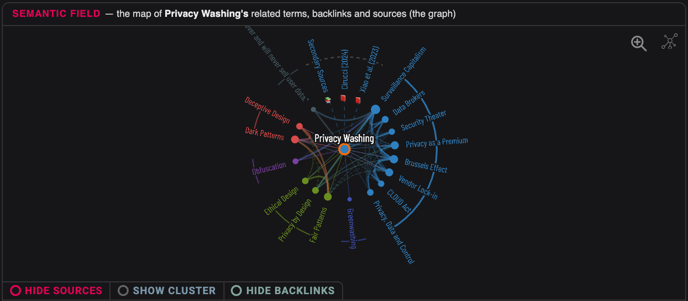
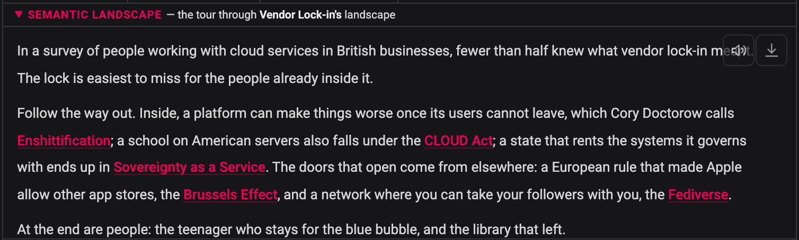
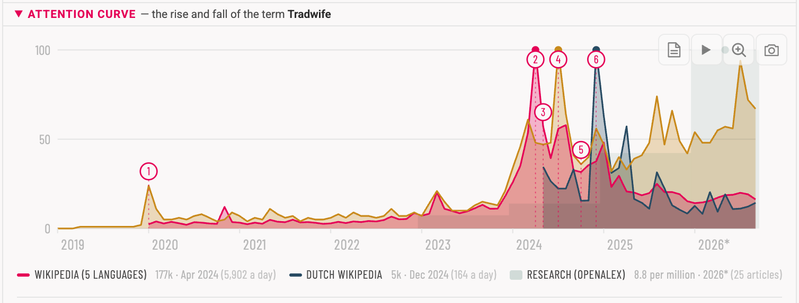
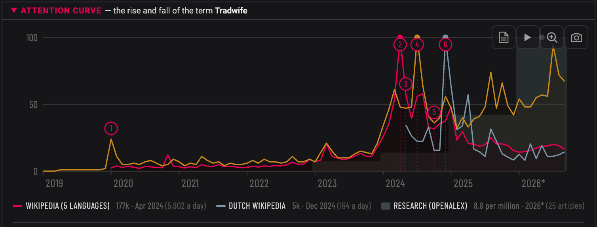
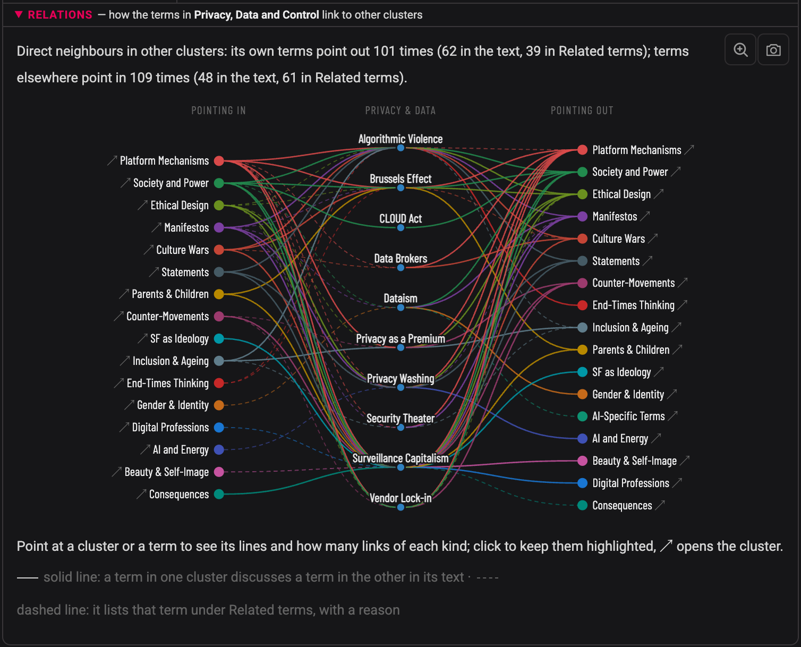
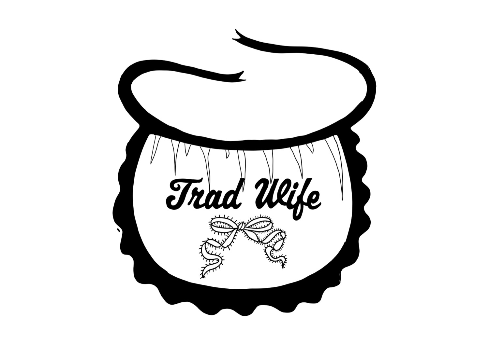
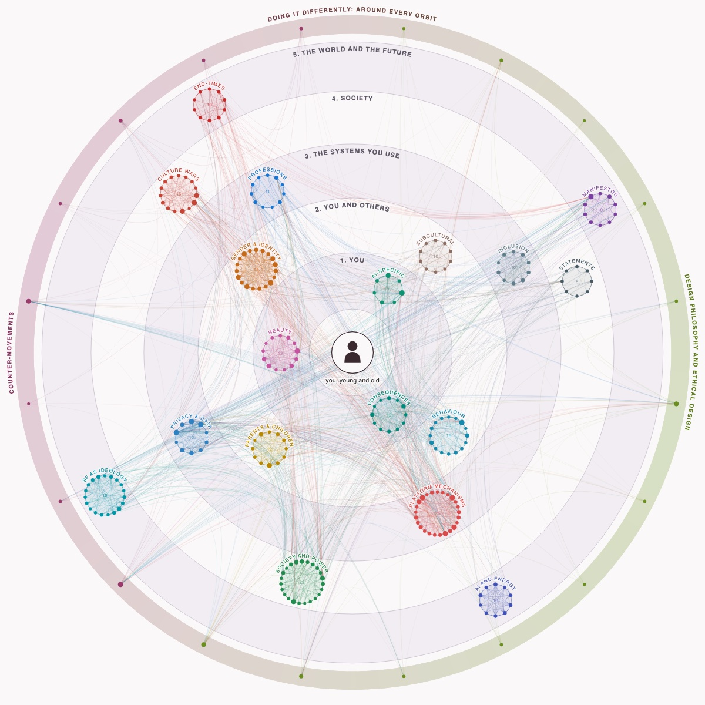

## What is the Cabinet of Digital Terms?

[[Surveillance Capitalism|Surveillance capitalism]]? [[Dopamine Feedback Loops|Dopamine loop]]? [[Dark Patterns|Dark pattern]]? [[Ghosting]]? [[Deinfluencing]]? [[Groomer]]? [[Red Pill|Red pill]]?

You have heard these terms, and you probably use some of them. But do you know where they came from, who introduced them and why, what they make visible and what they quietly leave out?

> *Capturing moving language. Every word here is a node in a power structure. Not a definition, a map.*

The **Cabinet of Digital Terms** gathers **260+ terms** from digital media, platform culture, politics and popular culture in **20+ clusters**, with **800+ external sources**. Every entry shows where a word comes from, who benefits from it, what it hides, and which other terms it belongs with. The Cabinet does not pretend to look from nowhere. As Donna Haraway put it: "Feminist objectivity means quite simply situated knowledges."

**Three ways in:** start with a [cluster](#browse-by-cluster) that names something you already sense but cannot yet put into words; search for a word with the search bar; or rest the pointer on a circle in the map above to see how far a cluster reaches.

The Cabinet is made by Marieke de Vogel within Project Digitale Alertheid at the [Communication & Multimedia Design programme](https://www.han.nl/opleidingen/hbo/communication-multimedia-design/voltijd/) of [HAN University of Applied Sciences](https://www.hanuniversity.com/en/), with the [Media Design Research Group](https://www.han.nl/onderzoek/lectoraten/lectoraat-media-design/).

---

## A living lab

The Cabinet is revised cluster by cluster, and you are reading it while that happens. *Privacy, Data and Control* is the first cluster to have been through the full method: sources read and split into primary and secondary, a semantic landscape, an attention curve, and relations argued in the text as well as listed. *Gender & Identity* was rewritten earlier on the research literature and will go through the same method next. In other clusters some entries, such as Tradwife and Sharenting, already carry several layers; most are at an earlier stage. Clusters get added and connections get corrected as the network shows what it is missing. Revised entries are being tested with readers, and what they tell us goes back into the method. If something is unclear or wrong, write to info@digitale-alertheid.nl.

### Where each entry stands

Some entries carry the method further than others.

<strong>What the three groups mean</strong>

**Full method:** the entry has been through every step. Its sources were read before anything was written and split into primary and secondary; each part answers its own question; relations to other terms are argued in the text, not only listed; the term's own name links back to the entry; and it has a semantic landscape and an attention curve. A cluster moves into this group when all its entries are done.

**Earlier round:** the entry has some of these layers, sources, a landscape or a curve, from a revision before the current method. It will go through the full method with its cluster.

**Not yet:** the entry is in its first form, written with AI assistance and checked for links and sources, without the layers above.

<strong>The entries per group</strong>

<!-- layers:start -->
| | entries | which |
|---|---|---|
| **Full method**: sources, landscape, curve, relations argued in the text | 10 | [[Privacy, Data and Control]]: [[Algorithmic Violence]] · [[Brussels Effect]] · [[CLOUD Act]] · [[Data Brokers]] · [[Dataism]] · [[Privacy as a Premium]] · [[Privacy Washing]] · [[Security Theater]] · [[Surveillance Capitalism]] · [[Vendor Lock-in]] |
| **Earlier round**: some of the layers, before the current method | 26 | [[AI-Specific Terms]]: [[AI-Ninja]] [[Beauty, Influencers & Self-Image]]: [[Virtual Influencer]] [[Behaviour & Relationships]]: [[Parasocial Relationship]] [[Gender & Identity]]: [[Alpha Male]] · [[Blackpill]] · [[High Value Man]] · [[Hypergamy]] · [[Incel]] · [[Looksmaxxing]] · [[Manosphere]] · [[MGTOW]] · [[NPC]] · [[Podcast-bro]] · [[Provider]] · [[Red Pill]] · [[Rizz]] · [[Sigma Male]] · [[SMV (Sexual Market Value)]] · [[Stay-at-home Girlfriend (SAHG)]] · [[Top 1% Man]] · [[Tradwife]] · [[Womanosphere]] [[Parents & Children]]: [[Sharenting]] [[Platform Mechanisms & Economics]]: [[Ragebaiting]] · [[Recommender Systems]] [[Subcultural Vocabulary and Platform Language]]: [[Gooner]] |
| **Not yet** | 224 | [[AI and Energy]] · [[AI-Specific Terms]] · [[Beauty, Influencers & Self-Image]] · [[Behaviour & Relationships]] · [[Consequences of Digital Behaviour]] · [[Counter-Movements]] · [[Culture Wars and Political Language]] · [[Design Philosophy and Ethical Design]] · [[End-Times Thinking and Elite Survivalism]] · [[Inclusion, Accessibility and Ageing]] · [[Manifestos]] · [[New Digital Professions]] · [[Parents & Children]] · [[Platform Mechanisms & Economics]] · [[SF as Ideology]] · [[Society and Power]] · [[Statements as Analytical Object]] · [[Subcultural Vocabulary and Platform Language]] |
<!-- layers:end -->

---

## How an entry is structured

Every entry has the same basic structure, and some carry more, depending on how far they have been revised (see [Where each entry stands](#where-each-entry-stands)). This is part of ongoing research within Project Digitale Alertheid (HAN University of Applied Sciences, [Media Design Research Group](https://www.han.nl/onderzoek/lectoraten/lectoraat-media-design/)): how to name what people half-know about digital culture, so that they recognise it, can talk about it and notice it next time. Open a part to see what it does, with an example.

### In every entry

<strong>Hook</strong>

A situation you recognise, and one question in which the term's tension sits. In [[Security Theater]]: *You took off your shoes at the airport security check and felt safer. Were you?*

<strong>Literal meaning</strong>

What the parts of the word say, and what appears when they come together that was in neither. In [[Security Theater]]: *security*, from Latin *securus*, without care, and a *theater*, a performance for an audience, where the audience is the people who are supposed to be protected.

<strong>Origin</strong>

Where the term came from, who introduced it, and how its meaning has shifted.

<strong>Definition</strong>

One sentence in plain language, set apart in a box.

<strong>The Appeal</strong>

What is true about the term, and who benefits from it.

<strong>The Friction</strong>

The answer to the hook's question: what the term hides, and how it works. In [[Security Theater]] it begins: *Often not: you do what the measure asks, and the risk stays where it was.*

<strong>Why This Matters</strong>

Why it helps to know the term, where things are done differently, and how to recognise it the next time. [[Vendor Lock-in]] ends: *The next time you sign up, or your school or employer chooses a system, ask what it would cost to leave in five years and whether you can take your data with you.*

<strong>Related terms</strong>

Other terms in the Cabinet, each with the reason it belongs beside this one. Terms the text itself discusses are linked in the text.

Above every entry stands its **semantic field**, the graph of its neighbours. The cards below show it, with the other drawings.

### Since the earlier rounds

<strong>Sources</strong>

The entries from the earlier rounds and the full method carry their sources on separate pages: at most two primary sources, peer-reviewed research that carries the analysis, and a bundle of secondary sources, from journalism to law. Every source in the text links to its page. See [[Privacy Washing]].

These entries also have a **semantic landscape** and an **attention curve**.

### Added in the full method

<strong>Signs in the text</strong>

Only in the entries that went through the full method: an asterisk \* opens the source of a claim, ▾ explains a name or a word, and ↘ leads to an original document or another entry.

<strong>Relations argued in the text</strong>

A neighbouring term is discussed in the part of the entry that needs it, so the text says why the two belong together; what adds nothing to the text stays under Related terms, with a reason. In the semantic field this shows as a solid line instead of a dashed one.

### Not part of a round

Three entries carry the term drawn as an image by a designer: **Narrative Typography**.

### On every cluster page

Each cluster page has a drawing of its **relations** with the other clusters.

### Drawings and images

The drawings and the image mentioned above, and one sketch. Click a card to turn it over.

Semantic Fieldin every entry

turn ↻

Semantic Field

The graph above every entry: the term in the middle, its neighbours on a ring grouped by cluster, its sources marked as books. An arrow shows which way a link runs; a line shows how well a relation is argued (thick: discussed in both texts, plain: in one text, dashed: only in Related terms, with a reason). Three switches show or hide the sources, the other terms in the cluster, and the entries that link here without being linked back.

[[Privacy Washing#semantic-field|Try it live in Privacy Washing ↗]]

turn back ↺

Semantic Landscapesince the earlier rounds

turn ↻

Semantic Landscape

The graph told as a short story: one thing that surprises, one thread followed through the neighbours, people at the end. The names in it are links. Vendor Lock-in begins: *In a survey of people working with cloud services in British businesses, fewer than half knew what vendor lock-in meant.*

[[Vendor Lock-in#semantic-landscape|Read it in Vendor Lock-in ↗]]

turn back ↺

Attention Curvesince the earlier rounds

turn ↻

Attention Curve

When the word drew attention: Wikipedia page views, search interest and research per year, each on its own scale. Numbered moments explain the peaks, or say plainly that no cause was found. In Tradwife the highest peak, April 2024, came three months before the newspaper profile usually credited with it; the likely cause was a radio podcast, and the note says it is not proven.

[[Tradwife#attention-curve|Try it live in Tradwife ↗]]

turn back ↺

Relationson every cluster page

turn ↻

Relations

On every cluster page: how its terms connect to the other clusters, in both directions. On the left the clusters whose terms point in, on the right the clusters its own terms point to. A solid line means a term discusses the other term in its text, a dashed line that it lists it under Related terms, with a reason. Point at a cluster or a term to see only its lines.

[[Privacy, Data and Control#relations|Try it live in Privacy, Data and Control ↗]]

turn back ↺

Narrative Typographyin three entries

By Narrative Typographer Marieke de Vogelturn ↻

Narrative Typography

The term drawn as an image by a designer, set above the definition, so the form of the word shows its meaning before you read it. So far in Tradwife (Marieke de Vogel), and in Sigma Male and Looksmaxxing (Anne-Marie Bruinsma); more will follow.

[[Tradwife#narrative-typography|See it in Tradwife ↗]] · [About Narrative Typography](https://digitale-alertheid.nl/narrative-typography-the-metaphoric-visualisation-of-terms/)

turn back ↺

You, in Orbits of Influencesketch

<a class="orbit-open" href="https://mastamarieke.github.io/Cabinet-of-Terms/static/orbits-of-influence.html" data-src="static/orbits-of-influence.html">Open the orbits ↗</a>turn ↻

You, in Orbits of Influence

The cluster map of the Cabinet, rearranged around you: every cluster sits on the orbit of how close it comes to your daily life, from your screen and the people around you to society and change over time. The orbits follow the five systems of the psychologist ==Urie Bronfenbrenner==[^bronfenbrenner], explained in the legend of the map. ==On a screen the far orbits reach you directly, with no parent or teacher in between== ([Navarro and Tudge, 2022](https://doi.org/10.1007/s12144-022-02738-3): Technologizing Bronfenbrenner, on forces from the outer systems that often circumvent parents and educators). Where a cluster sits is a choice, not a measurement; the lines are the links counted on 12 October 2026.

turn back ↺

---

## Browse by cluster

<strong>Platform Mechanisms & Economics</strong> — 25 terms

Platforms are not neutral tools. This cluster maps the technical and economic architecture through which platforms shape user behaviour — recommendation algorithms, dark patterns, gamification mechanics, and dopamine loops. The terms here name mechanisms that are easier to resist once they have a name.

→ [About this cluster](Cabinet-of-Digital-Terms/Platform-Mechanisms--and--Economics/)

- [[AI Slop]]
- [[AI as a Utility]]
- [[Age of Average]]
- [[Attention Economy]]
- [[Attention Harvesting]]
- [[BUMMER]]
- [[Biometric Surveillance]]
- [[Bot Farms]]
- [[Clickbait]]
- [[Dark Patterns]]
- [[Deceptive Design]]
- [[Dopamine Feedback Loops]]
- [[Empathy Exploit]]
- [[Enshittification]]
- [[Gamification Creep]]
- [[Ludic Loop]]
- [[Microtargeting]]
- [[Neuromarketing]]
- [[Nudging]]
- [[Predatory Design]]
- [[Echo Chamber]]
- [[Filter Bubble]]
- [[Ragebaiting]]
- [[Recommender Systems]]
- [[Shadow Banning]]
- [[Synthetic Generation]]

<strong>Society and Power</strong> — 23 terms

A small number of people now control the infrastructure that everyone depends on. This cluster maps the structural concepts describing the political-economic architecture of the digital age — technofeudalism, surveillance capitalism, cybernetic governance, the revolving door between regulation and industry.

→ [About this cluster](Cabinet-of-Digital-Terms/Society-and-Power/)

- [[Broligarchy]]
- [[Cybernetic Governance]]
- [[Digital-Military-Industrial Complex]]
- [[Dual-Use Technology]]
- [[Financial Fabulism]]
- [[Flood the Zone]]
- [[Fortress Futurism]]
- [[Founder Mode]]
- [[Grifters]]
- [[Grokipedia]]
- [[Hubris Syndrome]]
- [[Memecoin]]
- [[Military-Industrial Complex]]
- [[Muskism]]
- [[Narrative Engineering]]
- [[Panopticon]]
- [[Reconstruction Economy]]
- [[Revolving Door]]
- [[Social Credit System]]
- [[Sovereignty as a Service]]
- [[Techno King]]
- [[Technofascism]]
- [[Technofeudalism]]

<strong>Gender & Identity</strong> — 19 terms

The manosphere gave normative gender hierarchy a vocabulary, a ranking system, and a distribution network. This cluster maps terms that frame gender, attractiveness, and social status as measurable, ranked quantities — from SMV to tradwife, from looksmaxxing to incel.

→ [About this cluster](Cabinet-of-Digital-Terms/Gender--and--Identity/)

- [[Alpha Male]]
- [[Blackpill]]
- [[High Value Man]]
- [[Hypergamy]]
- [[Incel]]
- [[Looksmaxxing]]
- [[MGTOW]]
- [[Manosphere]]
- [[NPC]]
- [[Podcast-bro]]
- [[Provider]]
- [[Red Pill]]
- [[Rizz]]
- [[SMV (Sexual Market Value)]]
- [[Sigma Male]]
- [[Stay-at-home Girlfriend (SAHG)]]
- [[Top 1% Man]]
- [[Tradwife]]
- [[Womanosphere]]

<strong>Culture Wars and Political Language</strong> — 15 terms

Some political vocabulary does not describe disagreements — it terminates them. This cluster maps terms that frame political positions as medical threats, hostile infiltration, or biological facts. Understanding the mechanism is the first step toward resisting it.

→ [About this cluster](Cabinet-of-Digital-Terms/Culture-Wars-and-Political-Language/)

- [[Anti-Woke]]
- [[Conspirituality]]
- [[Deadnaming]]
- [[Deep State]]
- [[Dehumanization]]
- [[Deplatforming]]
- [[Doxing]]
- [[Great Replacement]]
- [[Groomer]]
- [[Purity Culture]]
- [[QAnon]]
- [[Social Contagion]]
- [[Subhuman]]
- [[Wellness-to-Alt-Right Pipeline]]
- [[Woke Mind Virus]]

<strong>Privacy, Data and Control</strong> — 10 terms

One click on "agree" accepted the terms of 835 companies. Read aloud, they take hundreds of hours. This cluster maps the gap between privacy rhetoric and privacy practice, and the mechanisms through which surveillance and control are exercised, obscured, or resisted.

→ [About this cluster](Cabinet-of-Digital-Terms/Privacy,-Data-and-Control/)

- [[Algorithmic Violence]]
- [[Brussels Effect]]
- [[CLOUD Act]]
- [[Data Brokers]]
- [[Dataism]]
- [[Privacy Washing]]
- [[Privacy as a Premium]]
- [[Security Theater]]
- [[Surveillance Capitalism]]
- [[Vendor Lock-in]]

<strong>Behaviour & Relationships</strong> — 16 terms

Ghosting, phubbing, doomscrolling — these words did not exist thirty years ago, and the behaviours they describe mostly did not either. This cluster maps new social patterns that emerged from platform architecture. They feel personal. They are also structural.

→ [About this cluster](Cabinet-of-Digital-Terms/Behaviour--and--Relationships/)

- [[Breadcrumbing]]
- [[Catfishing]]
- [[Cognitive Surrender]]
- [[Doomscrolling]]
- [[Flexing]]
- [[Ghosting]]
- [[Lurker]]
- [[Orbiting]]
- [[Phantom Vibration Syndrome]]
- [[Phatic Interaction]]
- [[Doom Spending]]
- [[Hustle Culture]]
- [[Imposter Syndrome]]
- [[Parasocial Relationship]]
- [[Phubbing]]
- [[Smombie]]

<strong>AI-Specific Terms</strong> — 7 terms

AI systems produce convincing text, agree with whatever you say, and gradually make certain skills feel unnecessary. None of this is accidental. This cluster maps what these systems quietly do to the people who use them.

→ [About this cluster](Cabinet-of-Digital-Terms/AI-Specific-Terms/)

- [[AI Dependency]]
- [[AI Hallucination]]
- [[AI Literacy]]
- [[AI-Ninja]]
- [[Cognitive Offloading]]
- [[Slopification]]
- [[Sycophancy (AI)]]

<strong>Consequences of Digital Behaviour</strong> — 12 terms

Tech neck, digital hoarding, cyberchondria, deskilling — these are not extreme cases or personal weaknesses. They are design outcomes. This cluster maps what happens to bodies and minds as a result of sustained engagement with systems optimised for engagement rather than wellbeing.

→ [About this cluster](Cabinet-of-Digital-Terms/Consequences-of-Digital-Behaviour/)

- [[Brain Rot]]
- [[Cyberchondria]]
- [[Deskilling]]
- [[Digital Amnesia]]
- [[Digital Hoarding]]
- [[Digital Overload]]
- [[FOMO]]
- [[Nomophobia]]
- [[Tech Neck]]
- [[Technostress]]
- [[Text Claw]]
- [[Wexting]]

<strong>Beauty, Influencers & Self-Image</strong> — 13 terms

The platform economy of appearance distributes body norms as aspiration content, makes comparison ambient, and produces clinical consequences at scale. This cluster maps how platforms shape how people see themselves and each other.

→ [About this cluster](Cabinet-of-Digital-Terms/Beauty,-Influencers--and--Self-Image/)

- [[Beauty Filter]]
- [[Body Dysmorphic Disorder]]
- [[Clean Girl Aesthetic]]
- [[Comparison Culture]]
- [[Curated Life]]
- [[Deinfluencing]]
- [[FOBO]]
- [[Fitfluencer]]
- [[Highlight Reel]]
- [[Influencer]]
- [[Main Character Energy]]
- [[That Girl]]
- [[Toxic Positivity]]
- [[Virtual Influencer]]

<strong>Parents & Children</strong> — 12 terms

Platforms are not designed with children in mind — they are designed for engagement. This cluster maps terms relevant to parents and young people navigating environments built to capture attention, normalise spending, and exploit social anxiety.

→ [About this cluster](Cabinet-of-Digital-Terms/Parents--and--Children/)

- [[Family Vlogging]]
- [[Gaming Disorder]]
- [[Kidfluencer]]
- [[Loot Boxes]]
- [[Momfluencer]]
- [[Online Grooming]]
- [[Predatory Design]]
- [[Roblox]]
- [[Robux]]
- [[Screen Time]]
- [[Sexting]]
- [[Sharenting]]

<strong>Counter-Movements</strong> — 8 terms

Digital detox, slow media, mindful scrolling — resistance to platform culture is real, but often distributed through the same platforms it critiques. This cluster maps recuperation: the mechanism through which the system absorbs its own criticism. Not all counter-movements are recuperated. The analytical work is distinguishing between the two.

→ [About this cluster](Cabinet-of-Digital-Terms/Counter-Movements/)

- [[Digital Detox]]
- [[Fediverse]]
- [[IRL (In Real Life)]]
- [[JOMO]]
- [[Mindful Scrolling]]
- [[Slow Media]]
- [[Tech-Free Challenge]]
- [[Unplugging]]

<strong>Design Philosophy and Ethical Design</strong> — 12 terms

Platform design is not inevitable — it is chosen. This cluster maps frameworks developed by designers who have decided that user interest matters as much as engagement metrics: Value Sensitive Design, fair patterns, participatory design, design justice.

→ [About this cluster](Cabinet-of-Digital-Terms/Design-Philosophy-and-Ethical-Design/)

- [[Adversarial Design]]
- [[Calm Technology]]
- [[De-bugging]]
- [[Deceptive Design]]
- [[Design Justice]]
- [[Ethical Design]]
- [[Fair Patterns]]
- [[Frictionful Design]]
- [[Participatory Design]]
- [[Persuasive Technology]]
- [[Privacy by Design]]
- [[Unblackboxing]]
- [[VSD (Value Sensitive Design)]]

<strong>SF as Ideology</strong> — 19 terms

The singularity, Mars colonisation, mind uploading — science fiction became the business plan. This cluster maps terms that originated as speculative fiction and are now deployed as serious policy or identity rhetoric. Ideological choices hide behind visionary language.

→ [About this cluster](Cabinet-of-Digital-Terms/SF-as-Ideology/)

- [[1984]]
- [[AGI]]
- [[Brain-Computer Interface]]
- [[Brave New World]]
- [[Cybernetic Collective]]
- [[Digital Frankenstein]]
- [[Doomerism]]
- [[Longtermism]]
- [[Mars Colonization]]
- [[Mind Uploading]]
- [[Doom Trolling]]
- [[Mimetic Desire]]
- [[Mythos Moment]]
- [[Neuralink]]
- [[Simulation Hypothesis]]
- [[Skynet]]
- [[The Matrix]]
- [[The Singularity]]
- [[Transhumanism]]

<strong>Manifestos</strong> — 10 terms

Five foundational texts shaped the ideological architecture of the digital age. Their vocabulary still circulates — sometimes as inspiration, sometimes as legitimation for the opposite of what was intended. This cluster maps what those texts actually argued, and what has been done with the argument since.

→ [About this cluster](Cabinet-of-Digital-Terms/Manifestos/)

- [[Black Box]]
- [[Cyberfeminism]]
- [[Cyborg]]
- [[Cyborg Musk]]
- [[Digital Libertarianism]]
- [[Hacker Ethic]]
- [[Informatics of Domination]]
- [[Obfuscation]]
- [[Objectivism (Rand)]]
- [[Situated Knowledge]]

<strong>AI and Energy</strong> — 10 terms

The digital economy has a body. It consumes water, occupies land, and draws power. This cluster maps the material reality behind digital abstraction — energy costs, water consumption, sacrifice zones, and the colonial dynamics of a cloud economy that extracts from the Global South.

→ [About this cluster](Cabinet-of-Digital-Terms/AI-and-Energy/)

- [[AI Energy Consumption]]
- [[Carbon Footprint of AI]]
- [[Data Center Water Consumption]]
- [[Digital Colonialism]]
- [[Externalized Costs]]
- [[Greenwashing]]
- [[Inference Cost]]
- [[Nuclear Renaissance]]
- [[Sacrifice Zones]]
- [[Training Run]]

<strong>Inclusion, Accessibility and Ageing</strong> — 10 terms

Digital systems structurally exclude certain groups — not by accident but by design choice. This cluster maps the digital divide, ageism in interface design, tech abandonment as a rational response to poor design, and the gap between accessibility compliance and genuine usability.

→ [About this cluster](Cabinet-of-Digital-Terms/Inclusion,-Accessibility-and-Ageing/)

- [[Accessibility]]
- [[Ageism (Digital)]]
- [[Digital Ageing]]
- [[Digital Divide]]
- [[Digital Exclusion]]
- [[Inclusive Design]]
- [[Silver Surfer]]
- [[Tech Abandonment]]
- [[UNC]]
- [[Universal Design]]

<strong>New Digital Professions</strong> — 11 terms

These jobs exist because something in the system is not working. Content moderators, algorithmic auditors, ghost workers — this cluster maps the professions that emerge from digital transformation: not the roles the tech industry promotes, but the roles that exist because something is broken.

→ [About this cluster](Cabinet-of-Digital-Terms/New-Digital-Professions/)

- [[Content Moderator]]
- [[Creator Economy]]
- [[De-installer]]
- [[Digital Coach]]
- [[Fact Checker]]
- [[Ghost Work]]
- [[Mechanical Turk]]
- [[Personal Branding]]
- [[Prompt Engineer]]
- [[Red Teamer]]
- [[Vibe Coder]]

<strong>Subcultural Vocabulary and Platform Language</strong> — 10 terms

Language that originates online, moves offline, and mutates constantly. This cluster maps how platform architecture shapes language, and how words travel from specific subcultures into general use, carrying their original context invisibly with them.

→ [About this cluster](Cabinet-of-Digital-Terms/Subcultural-Vocabulary-and-Platform-Language/)

- [[Coded -Pilled]]
- [[Algospeak]]
- [[Aurafarming]]
- [[Brain Rot]]
- [[Chad]]
- [[Cooked]]
- [[Crash-out]]
- [[Main Character Energy]]
- [[Gooner]]
- [[Ratio'd]]
- [[Tierlists S-Tier]]

<strong>End-Times Thinking and Elite Survivalism</strong> — 10 terms

Doomerism, longtermism, effective accelerationism, bunker preparation — this cluster maps ideologies that take the end of the world as given and build a power or identity project on it. Some are held by people with significant resources and political influence.

→ [About this cluster](Cabinet-of-Digital-Terms/End-Times-Thinking-and-Elite-Survivalism/)

- [[Armageddon Complex]]
- [[Dark MAGA]]
- [[Disaster Nationalism]]
- [[Doomsday Prep for the Super-Rich]]
- [[Endtime Fascism]]
- [[Millenarianism]]
- [[Prepperism]]
- [[Pro-natalism]]
- [[Seasteading]]
- [[e-acc (Effective Accelerationism)]]

<strong>Statements as Analytical Object</strong> — 8 terms

Executives speak in public. Sometimes they reveal more than they intended. This cluster treats quoted statements as analytical objects — sentences that expose the categorical frameworks and institutional assumptions of the people who made them.

→ [About this cluster](Cabinet-of-Digital-Terms/Statements-as-Analytical-Object/)

- [["500 million people installed that app in 60 days."]]
- [["Adding amplitude to war is obviously an issue."]]
- [["During a dynamic political environment."]]
- [["I could definitely see it."]]
- [["Like Prime, but with human beings."]]
- [["We have never and will never sell user data."]]
- [[Adolescence (Netflix, 2025)]]
- [[Tu Nube Seca Mi Río]]

---

## Who it is for

- **Researchers:** the genealogy of terms, with the sources behind every entry.
- **Teachers and students:** a vocabulary for thinking critically about the platforms you use every day, in media, sociology, computer science and design.
- **Designers and developers:** how design steers behaviour, and where it is done differently.
- **Policymakers:** how algorithms and data shape society, and the rules that answer them.
- **Healthcare professionals:** the human side of digital health tools, AI and data.
- **Digital citizens and activists:** a name for an uncomfortable feeling online, and words to push back with.

---

## How it was made

The Cabinet is written with **cartographic prompting**, a method developed within Project Digitale Alertheid. A large language model (Claude, ChatGPT and Lumo while exploring, Claude in production) receives writing instructions, search directions and the existing network of terms, so that every new term is placed: which cluster it belongs to, which terms it connects to, and why. The model proposes at every step; the curator chooses the terms and the sources, makes the final call, and sometimes overrides it. The method grew out of longer analyses made under the name *Media Cartografie*.

> **Cartographic prompting** (working definition): a prompting practice that takes cartography itself as input (a large language model is instructed with writing instructions, search directions, and content frameworks) so that the placement of digital terms in a relational network reveals which cluster a term belongs to and why.

The full method is described in **[Cartographic Prompting: Curatorial Practice Alongside Karpathy’s LLM Wiki](https://digitale-alertheid.nl/beyond-karpathys-llm-wiki-cartographic-prompting-as-curatorial-practice/)** (31 July 2026).

---

## Part of Project Digitale Alertheid

The Cabinet is one of the **Conversation Pieces** of Project Digitale Alertheid: artefacts that let people feel a form of digital manipulation before it is named, so that they recognise it in the moment and start talking about it. The pieces share one source. The Cabinet names the terms, Narrative Typography gives them a visual form, and the Term Seeker and the Doctor Alert coat bring them into physical space, as words to reach for and words worn on the body.

Research names the manipulation, and regulation such as the [Digital Services Act](https://eur-lex.europa.eu/eli/reg/2022/2065/oj "Read the Digital Services Act") limits it. Neither builds what the project calls ==experiential resilience==[^resilience], the ability to recognise manipulation when it happens. The Conversation Pieces add that as a third route, next to critique and regulation. Each piece is also a knowledge product: research shapes the artefact, and what people say when they meet it goes back into the research. As the project's paper ==Staging Digital Friction==[^paper] puts it: *"By making the crossing from knowing to feeling playable, it brings research on dark patterns into everyday experience."*

- **[Soulmeter](https://digitale-alertheid.nl/the-soulmeter-how-much-of-your-soul-have-you-sold-to-the-internet/)**, an installation: a quiz board beside a life-size smartphone, where every wrong answer costs part of your soul (teenagers and adults). How much of your soul have you sold to the internet?
- **[Wheel of Dark Patterns](https://digitale-alertheid.nl/the-wheel-of-dark-patterns-spin-match-recognise/)**, a physical and digital wheel with the dark patterns in three rings (general public). Spin, match, recognise the manipulation.
- **[Cabinet of Digital Terms](https://digitale-alertheid.nl/cabinet-of-digital-terms-a-map-of-the-digital-world-in-267-terms/)**, a web-based knowledge bank: a network of terms to click, search and follow (adults). You are here.
- **[Narrative Typography](https://digitale-alertheid.nl/narrative-typography-the-metaphoric-visualisation-of-terms/)**, illustrated two-sided cards: the image first, the definition on the back (across the collection). The form of a word reveals its meaning before you read it.
- **[Term Seeker](https://digitale-alertheid.nl/the-term-seeker-reaching-for-language-in-a-digital-world/)**, an interactive installation: digital terms drift past, and you reach out with your hand to catch one (general public). Reach for a term, receive a provocation.
- **[Doctor Alert: The Digital Banner Coat](https://digitale-alertheid.nl/doctor-alert-the-digital-banner-coat/)**, a wearable: a lab coat printed with digital terms, with a pulsing light (general public). The body as message.
- **[Rad van Rollen](https://digitale-alertheid.nl/rad-van-rollen-playing-your-way-to-digital-awareness/)**, a role-play game with a rotating wheel and 3D characters, in which children speak for big tech (children, Grade 7). Dark patterns translated into a language children can debate.
- **[Mind Trick Machine](https://digitale-alertheid.nl/mind-trick-machine-from-dark-patterns-to-dark-encounters/)**, a workshop with brain cards and cards on current topics (adults). Nine metaphorical brains, from dark patterns to dark encounters.
- **[The Non Fluencer](https://digitale-alertheid.nl/the-non-fluencer-seeing-the-unseen-in-an-age-of-algorithms/)**, large prints placed in non-places, where people pass through without stopping (general public). Refusing the logic of the algorithm.
- **NO A-MEAZING** *(coming soon)*. The only way to win is to refuse to play.

Interested in the research, in using the Cabinet in teaching, or in contributing? Write to info@digitale-alertheid.nl.

---

*For information about this project, its method, and its terms of use, see [[Disclaimer of the Cabinet of Digital Terms]].*

[^resilience]: A term from the project's paper. It builds on online resilience, which Vissenberg, d'Haenens and Livingstone describe as "the capacity to bounce back from adversity by, for instance, coping with online risks in an effective way". In the Conversation Pieces that resilience grows from an experience that is staged safely and then talked about. [European Psychologist: 'Digital Literacy and Online Resilience as Facilitators of Young People's Well-Being?'](https://doi.org/10.1027/1016-9040/a000478)
[^paper]: A paper by Marieke de Vogel, Wouter Sluis-Thiescheffer and Jasper Jeurens (HAN University of Applied Sciences, Media Design Research Group, 2026) on the Conversation Pieces, with a pilot of the Soulmeter among players aged 14 to 66.
[^bronfenbrenner]: Developmental psychologist at Cornell University (1917–2005). In *The Ecology of Human Development* (1979) he described how a child grows up inside nested systems, from the family to the culture around it.
