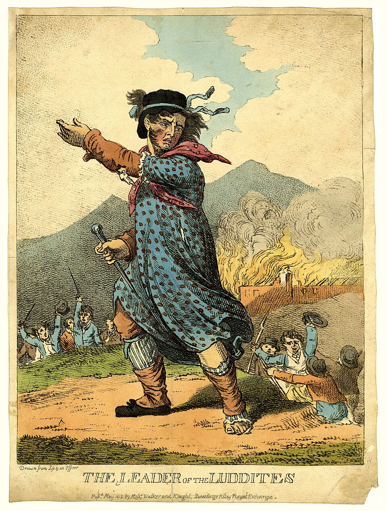

## What is the Cabinet of Digital Terms?

[[Surveillance Capitalism]], [[Dark Patterns|Dark Pattern]], [[Ghosting]], [[Red Pill]]?

You have heard these terms, and you probably use some of them. But do you know where they came from, who introduced them and why, what they make visible and what they quietly leave out?

The **Cabinet of Digital Terms** is a ==Cabinet of Curiosities==[^curiosities] for the digital age: it gathers **260+ terms** from digital media, platform culture, politics and popular culture in **20 clusters**, with **800+ external sources**. Every entry shows where a word comes from, who benefits from it, what it hides, and which other terms it belongs with. The Cabinet does not pretend to look from nowhere. As Donna Haraway put it: "Feminist objectivity means quite simply situated knowledges."

> *"Sometimes my jaw drops. Sometimes I feel misled, amazed or appalled by the digital world. That is why I started Project Digital Alertness. Together with designers, artists, researchers and students, we make the friction of this world visible in something you can experience, so that you discover connections and choose your own way more consciously. I am critical of AI, although I use it. Call me a ==Termophile==[^termophile]."*
>
> **Marieke de Vogel**, initiator of Project Digital Alertness

---

## Clusters and their unexpected questions

A cluster groups terms that belong to the same situation: the same platforms, the same people, the same pressure. Each cluster asks one question about the digital world, and its terms help you answer it. A term lives in one cluster, and its links show where it reaches into others.

 

drawingWhose resources are powering your query?

AI and Energyturn ↻

 
AI and EnergyWhose resources are powering your query?The material reality behind digital abstraction.10 terms<a class="go" href="Cabinet-of-Digital-Terms/AI-and-Energy/">Open cluster →</a>turn back ↺
 

 

drawingWhat do you lose when the machine thinks for you?

AI-Specific Termsturn ↻

 
AI-Specific TermsWhat do you lose when the machine thinks for you?What AI systems quietly do to the people who use them.7 terms<a class="go" href="Cabinet-of-Digital-Terms/AI-Specific-Terms/">Open cluster →</a>turn back ↺
 

 

drawingWhose standard of beauty are you measuring yourself against?

Beauty, Influencers &amp; Self-Imageturn ↻

 
Beauty, Influencers &amp; Self-ImageWhose standard of beauty are you measuring yourself against?The platform economy of appearance.14 terms<a class="go" href="Cabinet-of-Digital-Terms/Beauty,-Influencers--and--Self-Image/">Open cluster →</a>turn back ↺
 

 

drawingWhich of your habits were designed for you?

Behaviour &amp; Relationshipsturn ↻

 
Behaviour &amp; RelationshipsWhich of your habits were designed for you?The new social patterns that emerged from platform architecture.16 terms<a class="go" href="Cabinet-of-Digital-Terms/Behaviour--and--Relationships/">Open cluster →</a>turn back ↺
 

 

drawingWhat has changed in you that you have not noticed yet?

Consequences of Digital Behaviourturn ↻

 
Consequences of Digital BehaviourWhat has changed in you that you have not noticed yet?What digital systems leave behind.12 terms<a class="go" href="Cabinet-of-Digital-Terms/Consequences-of-Digital-Behaviour/">Open cluster →</a>turn back ↺
 

 

drawingIs this resistance, or is it content about resistance?

Counter-Movementsturn ↻

 
Counter-MovementsIs this resistance, or is it content about resistance?A specific mechanism: resistance that reproduces what it resists.8 terms<a class="go" href="Cabinet-of-Digital-Terms/Counter-Movements/">Open cluster →</a>turn back ↺
 

 

drawingWhat kind of response does this language make seem reasonable?

Culture Wars and Political Languageturn ↻

 
Culture Wars and Political LanguageWhat kind of response does this language make seem reasonable?Terms that frame political positions as medical threats, hostile infiltration, or biological facts.15 terms<a class="go" href="Cabinet-of-Digital-Terms/Culture-Wars-and-Political-Language/">Open cluster →</a>turn back ↺
 

 

drawingWhat would you build if you were not optimising for attention?

Design Philosophy and Ethical Designturn ↻

 
Design Philosophy and Ethical DesignWhat would you build if you were not optimising for attention?Working frameworks from designers who decided that user interest matters.12 terms<a class="go" href="Cabinet-of-Digital-Terms/Design-Philosophy-and-Ethical-Design/">Open cluster →</a>turn back ↺
 

 

drawingWho benefits from the end of the world being inevitable?

End-Times Thinking and Elite Survivalismturn ↻

 
End-Times Thinking and Elite SurvivalismWho benefits from the end of the world being inevitable?Ideologies that take collapse as given and build power or identity on it.10 terms<a class="go" href="Cabinet-of-Digital-Terms/End-Times-Thinking-and-Elite-Survivalism/">Open cluster →</a>turn back ↺
 

 

drawingWhat happens when gender becomes a market?

Gender &amp; Identityturn ↻

 
Gender &amp; IdentityWhat happens when gender becomes a market?The vocabulary of the manosphere and its adjacent spaces.19 terms<a class="go" href="Cabinet-of-Digital-Terms/Gender--and--Identity/">Open cluster →</a>turn back ↺
 

 

drawingWho was not in the room when this was built?

Inclusion, Accessibility and Ageingturn ↻

 
Inclusion, Accessibility and AgeingWho was not in the room when this was built?A blind spot in the digital debate.10 terms<a class="go" href="Cabinet-of-Digital-Terms/Inclusion,-Accessibility-and-Ageing/">Open cluster →</a>turn back ↺
 

 

drawingWho is using this concept, and to what end?

Manifestosturn ↻

 
ManifestosWho is using this concept, and to what end?The foundational texts and concepts that built the ideological architecture of the digital age.10 terms<a class="go" href="Cabinet-of-Digital-Terms/Manifestos/">Open cluster →</a>turn back ↺
 

 

drawingWho is doing the work the platform claims the algorithm does?

New Digital Professionsturn ↻

 
New Digital ProfessionsWho is doing the work the platform claims the algorithm does?Professions that emerge from digital transformation.11 terms<a class="go" href="Cabinet-of-Digital-Terms/New-Digital-Professions/">Open cluster →</a>turn back ↺
 

 

drawingWho is responsible for the child in the feed?

Parents &amp; Childrenturn ↻

 
Parents &amp; ChildrenWho is responsible for the child in the feed?The specific ways platforms exploit the vulnerabilities of minors.12 terms<a class="go" href="Cabinet-of-Digital-Terms/Parents--and--Children/">Open cluster →</a>turn back ↺
 

 

drawingWhat is this platform designed to make you do?

Platform Mechanisms &amp; Economicsturn ↻

 
Platform Mechanisms &amp; EconomicsWhat is this platform designed to make you do?How platforms operate, steer, and profit.25 terms<a class="go" href="Cabinet-of-Digital-Terms/Platform-Mechanisms--and--Economics/">Open cluster →</a>turn back ↺
 

 

drawingWhat does &quot;your data is safe with us&quot; actually mean?

Privacy, Data and Controlturn ↻

 
Privacy, Data and ControlWhat does &quot;your data is safe with us&quot; actually mean?The gap between privacy rhetoric and privacy practice.10 terms<a class="go" href="Cabinet-of-Digital-Terms/Privacy,-Data-and-Control/">Open cluster →</a>turn back ↺
 

 

drawingWho benefits from making the future sound inevitable?

SF as Ideologyturn ↻

 
SF as IdeologyWho benefits from making the future sound inevitable?Science fiction terms deployed as serious policy or identity rhetoric.19 terms<a class="go" href="Cabinet-of-Digital-Terms/SF-as-Ideology/">Open cluster →</a>turn back ↺
 

 

drawingWho owns the infrastructure you cannot live without?

Society and Powerturn ↻

 
Society and PowerWho owns the infrastructure you cannot live without?The structural concepts describing the political-economic architecture of the digital age.23 terms<a class="go" href="Cabinet-of-Digital-Terms/Society-and-Power/">Open cluster →</a>turn back ↺
 

 

drawingWhat does this sentence assume about the world?

Statements as Analytical Objectturn ↻

 
Statements as Analytical ObjectWhat does this sentence assume about the world?Quoted statements as analytical objects.8 terms<a class="go" href="Cabinet-of-Digital-Terms/Statements-as-Analytical-Object/">Open cluster →</a>turn back ↺
 

 

drawingWhere did this word come from, and what did it mean when it got there?

Subcultural Vocabulary and Platform Languageturn ↻

 
Subcultural Vocabulary and Platform LanguageWhere did this word come from, and what did it mean when it got there?The mechanisms by which platform architecture shapes language.10 terms<a class="go" href="Cabinet-of-Digital-Terms/Subcultural-Vocabulary-and-Platform-Language/">Open cluster →</a>turn back ↺
 

---

## How to use the Cabinet

Wander through the Cabinet and let serendipity lead you: start with a [cluster](#clusters-and-their-unexpected-questions) that names something you already sense but cannot yet put into words, search for a term with the search bar, or rest the pointer on a circle in the map above to see how far a cluster reaches.

Or start with a question:

- *You meant to play for ten minutes and spend nothing. Who knew in advance where you would give in?* → [[Predatory Design]]
- *You watched her clean and felt calm. She was paid for it. How much were you paid?* → [[Cleanfluencer]]
- *You took off your shoes at the airport security check and felt safer. Were you?* → [[Security Theater]]

---

## Who it is for

- **Researchers:** the genealogy of terms, with the sources behind every entry.
- **Teachers and students:** a vocabulary for thinking critically about the platforms you use every day, in media, sociology, computer science and design.
- **Designers and developers:** how design steers behaviour, and where it is done differently.
- **Policymakers:** how algorithms and data shape society, and the rules that answer them.
- **Healthcare professionals:** the human side of digital health tools, AI and data.
- **Digital citizens and activists:** a name for an uncomfortable feeling online, and words to push back with.

---

## Part of the project Digital Alertness

The Cabinet is one of the project's **Conversation Pieces**: works to play with that let you feel or discover a form of digital manipulation.

<a class="orbit-open" href="https://mastamarieke.github.io/Cabinet-of-Terms/static/project.html" data-src="static/project.html">More about the project</a>

---

<small>The Cabinet of Digital Terms is initiated and curated by Marieke de Vogel. It is developed within Project Digital Alertness, with support from the [Communication & Multimedia Design programme](https://www.han.nl/opleidingen/hbo/communication-multimedia-design/voltijd/) of [HAN University of Applied Sciences](https://www.hanuniversity.com/en/) and in dialogue with the [Media Design Research Group](https://www.han.nl/onderzoek/lectoraten/lectoraat-media-design/).</small>

<nav class="pager" aria-label="Pages about the Cabinet, page 1 of 3"><ol class="pg-steps"><li class="pg-step now"><a href="./" aria-current="page">1Part 1Start</a></li><li class="pg-step next"><a href="./how-it-is-made">2Part 2How it is made</a></li><li class="pg-step next"><a href="./how-an-entry-grows">3Part 3How an entry grows</a></li></ol><a class="pg-arrow next" href="./how-it-is-made" aria-label="Next page: How it is made">How it is made→</a></nav>

[^termophile]: The Leader of the Luddites (1812), hand-coloured etching, public domain.A made-up term: a hunter-gatherer of terms, who loves them for what they make visible and what they hide. Not against new technology, but always asking what the terms for it do to us, a little like the first Luddites, who were not against machines as such, but against the way factory owners used them against workers. [Wikimedia Commons: 'The Leader of the Luddites'](https://commons.wikimedia.org/wiki/File:Luddite.jpg) [The Conversation: 'What's a Luddite? An expert on technology and society explains'](https://theconversation.com/whats-a-luddite-an-expert-on-technology-and-society-explains-203653)

[^curiosities]: In sixteenth-century Europe, collectors filled rooms with objects whose categories had not yet been defined, a Wunderkammer in German. The Cabinet does the same with words: its terms arrive before their categories exist, and stand side by side so you can compare them. Wonder makes you look closer, questioning keeps you critical. [Digital Alertness: 'Cabinet of Digital Terms: A Map of the Digital World'](https://digitale-alertheid.nl/cabinet-of-digital-terms-a-map-of-the-digital-world-in-267-terms/)
